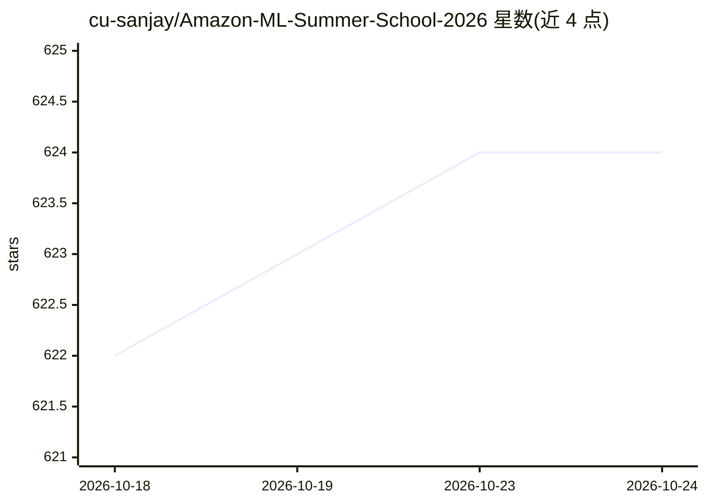

# cu-sanjay/Amazon-ML-Summer-School-2026

⭐ 624 · NOASSERTION · 推送 2026-07-02 · [GitHub](https://github.com/cu-sanjay/Amazon-ML-Summer-School-2026) · [官网](https://amazonml.vercel.app/interview-prep) · 个人维护

**Amazon ML Summer School 课程资料与历年真题汇编，面向备考学生**

收录 Amazon ML Summer School 2025 的课程材料、考试资源与练习内容：包含 8 个模块（监督学习、深度神经网络、降维、无监督学习、概率图模型、序列学习、因果推断、强化学习）的完整笔记与总结，各模块末尾附练习任务与编码练习。另收录 2023-2025 年选择测试的 MCQ、编程题、官方样题（Scaler 提供、已解答）及两套 2025 评估题。面向 2027/2028 届毕业的印度高校学生，提供申请链接与选拔测试格式说明（20 道 MCQ + 2 道编程题，60 分钟）。以 PDF 与 Markdown 形式在 GitHub 上直接阅读或下载。

## 筛选速览

| 维度 | 判定 | 备注 |
|---|---|---|
| AI 角色 | `ai-knowledge` | 知识聚合/清单类 |
| 许可风险 | `none` | NOASSERTION |
| 部署形态 | `None` |  |
| 模型依赖 | — | README 未给出锁定关系 |
| 硬件要求 | — | 无带数字的原话,不猜 |
| 安装摩擦 | `low` | 无编译、无系统依赖或容器化 |
| 成熟度 | — | 结构信号不足 |

## 能力要点

- AMSS 2025 全部 8 个模块的完整笔记与课程总结
- 2023-2025 年选拔测试 MCQ、编程题与官方样题（已解答）
- 每模块末附练习任务与编码练习
- 额外的 ML 学习路线图与深度学习资料

## 适用场景

- 备考 Amazon ML Summer School 选拔测试（MCQ + 编程题）
- 按模块复习机器学习核心课程内容
- 查找 ML 面试与基础学习的补充资料

## 场景标签

`教程课程` · 领域:学习与行业

## 证据(README 行号)

> L20: > This repository also hosts **course materials, assessment resources, practice content, and complete session summa
> L65: * 📄 **Programming Questions (2023)**: Coding questions asked during the 2023 selection assessment.
> L71: * 📂 **AMSS 2025 Module Summaries**: Core directory containing complete notes, curriculum overviews, and summaries f

## 星数曲线

2026-10-18 622 → 2026-10-24 624（+2）

---
*卡片 v1 · prompt 1.4 · 生成 2026-10-21 · 置信度 high · 依据 README sha `b8ca0555bd4b` · [字段定义](../../DATASET.md)*
