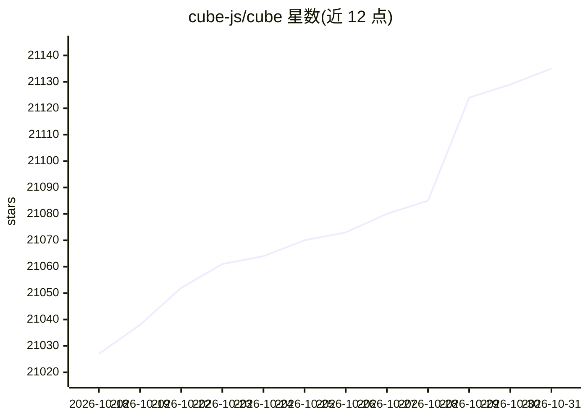

# cube-js/cube

⭐ 21,135 · Rust · NOASSERTION · 推送 2026-10-30 · [GitHub](https://github.com/cube-js/cube) · [官网](https://cube.dev) · 组织维护

**面向 AI、BI 与嵌入式分析的开源语义层**

Cube Core 是开源语义层：以代码形式集中定义指标、维度、关联与访问规则，通过 SQL、REST 和 GraphQL API 向下游暴露给 BI 工具、自定义应用或 AI agent。支持所有 SQL 数据源（Snowflake、Databricks、BigQuery、Presto、Amazon Athena、Postgres 等），内置关系缓存引擎以降低 API 请求延迟并支撑高并发。无头设计，不附带 UI。Docker 本地或自托管运行；开发模式存在认证绕过，仅限本机调试，不可用于生产。

## 筛选速览

| 维度 | 判定 | 备注 |
|---|---|---|
| AI 角色 | `ai-ecosystem` | LLM/agent 周边工具 |
| 许可风险 | `none` | NOASSERTION |
| 部署形态 | `self-host` | docker 或自建部署 |
| 模型依赖 | — | README 未给出锁定关系 |
| 硬件要求 | — | 无带数字的原话,不猜 |
| 安装摩擦 | `low` | 无编译、无系统依赖或容器化 |
| 成熟度 | — | 结构信号不足 |

## 动量与使用信号

- 维护:`active` — 距上次 push 0.7 天,年发版 100,374 位贡献者
- 涨星:近 1 天 **+8**(自 20261016 起算)
- 下载:GitHub Release 附件 累计 2,321,961(100 个 release)

## 能力要点

- 一次定义指标/维度/访问规则，经 SQL、REST、GraphQL API 供下游消费
- 兼容 Snowflake、Databricks、BigQuery、Athena、Postgres 等 SQL 数据源
- 内置关系缓存引擎，提供亚秒级延迟与高并发
- 无头设计，数据模型与商业版 Cube 双向兼容

## 适用场景

- 为 AI agent 提供受治理的语义层 API
- 自建嵌入式分析，把指标接口暴露给产品
- 统一内部 BI 工具的指标定义，避免重复建模

## 场景标签

`数据分析` · 领域:效率与自动化

## 证据(README 行号)

> L9: __Cube Core is the open-source semantic layer.__ Define metrics, dimensions, joins, and access rules once in code, t
> L26: Cube Core is an open, standalone semantic layer that any analytics application or AI agent can consume through stan
> L66: Cube is our commercial product — an agentic analytics platform built on Cube Core. Same semantic layer underneath, 

## 星数曲线

2026-10-18 21,027 → 2026-10-31 21,135（+108）

---
*卡片 v1 · prompt 1.4 · 生成 2026-10-18 · 置信度 high · 依据 README sha `92660131f580` · [字段定义](../../DATASET.md)*
