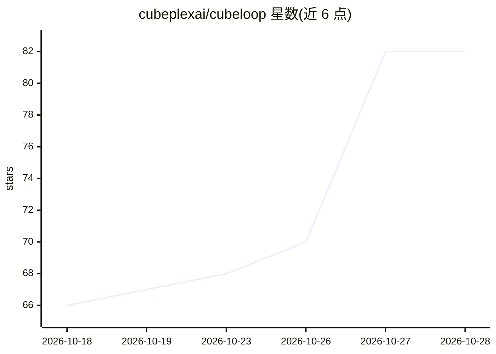

# cubeplexai/cubeloop

⭐ 82 · Python · MIT · 推送 2026-10-27 · [GitHub](https://github.com/cubeplexai/cubeloop) · [官网](https://cubeloop.dev) · 组织维护

**异步原生 Python agent 框架：以 while 循环建模 agent 逻辑**

Python 编写的 async 原生 agent 框架，将 agent 逻辑建模为线性 while 循环（run_agent_loop），区别于图结构运行时。通过 Provider 协议接入 Anthropic/OpenAI，支持 FallbackBoundModel 链式降级、函数式工具声明与并行执行、8 类中间件钩子、延迟工具组（按需展开 MCP 工具 schema）、append-only 检查点（SQLite/Postgres/MySQL，O(1) 写入）、FauxProvider 无 key 测试，以及内置 OpenTelemetry 追踪与 CLI。需 Python>=3.11，pip/uv 安装。

## 筛选速览

| 维度 | 判定 | 备注 |
|---|---|---|
| AI 角色 | `ai-ecosystem` | LLM/agent 周边工具 |
| 许可风险 | `permissive` | MIT |
| 部署形态 | `library` | 以包/库形式分发 |
| 模型依赖 | locked-api |  |
| 硬件要求 | — | 无带数字的原话,不猜 |
| 安装摩擦 | `low` | 无编译、无系统依赖或容器化 |
| 成熟度 | — | 结构信号不足 |

## 能力要点

- Provider 协议内置 Anthropic/OpenAI，支持 FallbackBoundModel 自动降级链
- append-only 检查点，仅写新消息，对话变长不增加 DB I/O
- 延迟工具组按需加载 MCP 工具 schema，保持 prompt cache 字节稳定
- 内置 OpenTelemetry 追踪（GenAI semconv）与 cubeloop trace CLI

## 适用场景

- 构建可持久化、可调试的 LLM agent
- 接入多个 MCP 服务器时控制上下文占用
- 为 agent 运行做 OpenTelemetry 可观测与 token/缓存命中率分析

## 场景标签

`Agent 框架` `LLM 可观测性` · 领域:Agent 开发

## 证据(README 行号)

> L12: CubeLoop is a Pythonic, async-native agent framework designed for high performance, readability, and production-gra
> L293: Architecture inspired by pi-agent-core (TypeScript) and LangGraph; CubeLoop is an independent Python reimplementat

## 星数曲线

2026-10-18 66 → 2026-10-28 82（+16）

---
*卡片 v1 · prompt 1.4 · 生成 2026-10-24 · 置信度 mid · 依据 README sha `a2e5c7946519` · [字段定义](../../DATASET.md)*
