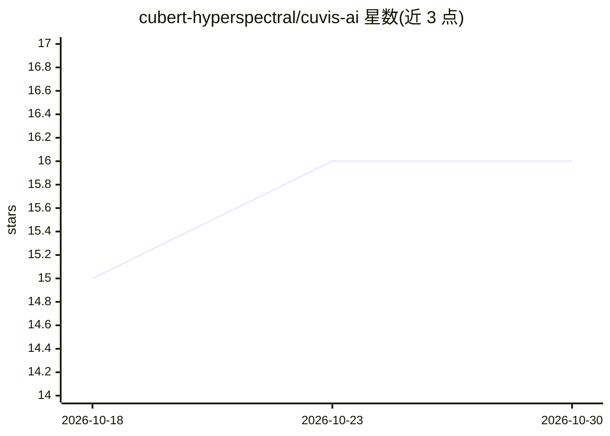

# cubert-hyperspectral/cuvis-ai

⭐ 16 · Jupyter Notebook · Apache-2.0 · 推送 2026-10-29 · [GitHub](https://github.com/cubert-hyperspectral/cuvis-ai) · [官网](https://docs.cuvis.ai/) · 组织维护

**构建高光谱视频 AI 处理管线的模块化节点框架**

由 Cubert（高光谱相机制造商）维护的开源框架，用于搭建处理高光谱视频数据的 AI 管线：管线由可复用的模块化节点组成，本仓库提供 40+ 领域节点（异常检测、预处理、波段选择等），核心编排、两阶段训练、gRPC 服务与插件系统在 cuvis-ai-core 仓库；数据读取依赖 cuvis-ai-dataloader 插件（含 Cuvis SDK，支持 .cu3s/.cu3 与 TIFF+PNG 格式）。通过 uv/pip 作为库安装，GPU 支持需另参阅安装指南配置 CUDA。

## 筛选速览

| 维度 | 判定 | 备注 |
|---|---|---|
| AI 角色 | `ai-ecosystem` | LLM/agent 周边工具 |
| 许可风险 | `permissive` | Apache-2.0 |
| 部署形态 | `library` | 以包/库形式分发 |
| 模型依赖 | — | README 未给出锁定关系 |
| 硬件要求 | — | 无带数字的原话,不猜 |
| 安装摩擦 | `medium` | 含编译或系统依赖之一 |
| 成熟度 | — | 结构信号不足 |

## 能力要点

- 40+ 领域专用节点（异常检测、预处理、波段选择等）
- 模块化节点 + 插件系统 + gRPC 服务架构
- 两阶段训练机制，支持实时环境部署
- 可插拔数据模块支持 .cu3s/.cu3 与 TIFF+PNG

## 适用场景

- 为高光谱视频数据搭建从预处理到模型应用的管线
- 在高光谱硬件与应用之间做实时处理与部署
- 通过插件扩展自定义处理节点或外部集成

## 场景标签

`图像视频处理` · 领域:感知与多模态

## 证据(README 行号)

> L11: Cuvis.AI is an opensource and extensible framework for building AI powered processing pipelines for hyperspectral v
> L13: Pipelines are built from reusable modular nodes and can be extended with custom plugins or external integrations.

## 星数曲线

2026-10-18 15 → 2026-10-30 16（+1）

---
*卡片 v1 · prompt 1.4 · 生成 2026-10-30 · 置信度 high · 依据 README sha `5636356e87b0` · [字段定义](../../DATASET.md)*
