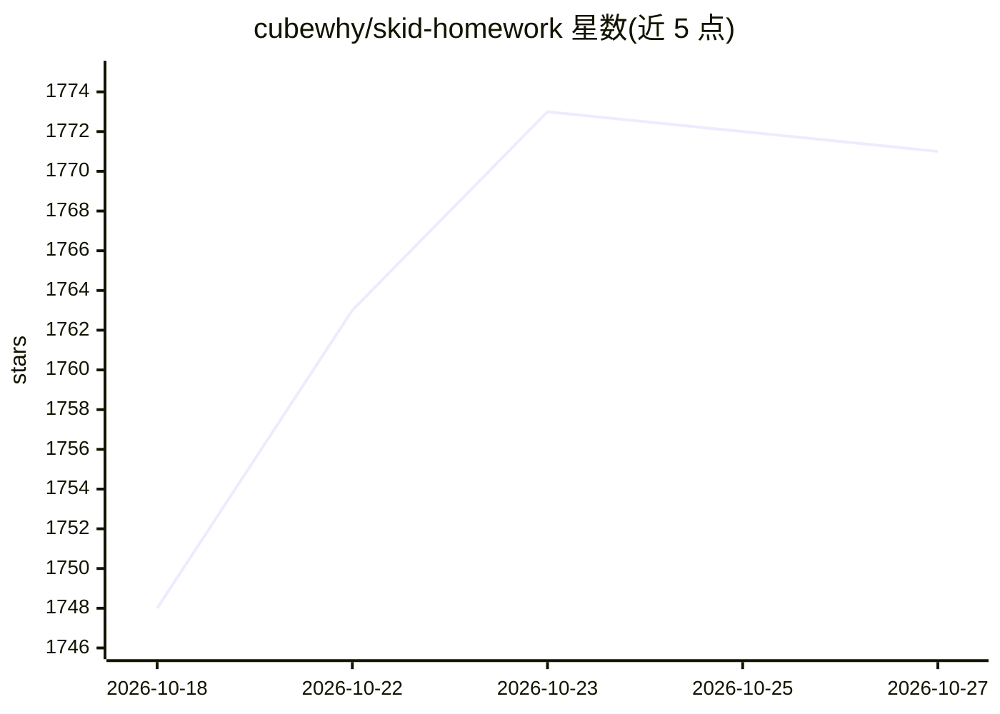

# cubewhy/skid-homework

⭐ 1,771 · TypeScript · GPL-3.0 · 推送 2026-09-14 · [GitHub](https://github.com/cubewhy/skid-homework) · [官网](https://skid.cubewhy.dev) · 个人维护 · 中文 README

**浏览器端 LLM 作业解题平台：拍照/上传题目生成答案**

基于 Next.js 的 Web 应用（打滑作业平台），用户上传多张图片或 PDF 题目，通过 Gemini API 或 OpenAI 兼容 API 调用 LLM 生成解答，而非题库检索。提供纯键盘快捷键工作流、可自定义全局提示词与答案风格、单个答案按 / 改进重写、绘图工具（JSXGraph/Mermaid/SVG）、ADB 连接安卓手机截图（WebUSB）、本地持久化解析（实验性）。一切在浏览器内运行，无遥测，官方实例部署于 skid.996every.day，支持 Vercel 与 Docker 部署，GPL-3.0 授权。

## 筛选速览

| 维度 | 判定 | 备注 |
|---|---|---|
| AI 角色 | `ai-native` | 本体是模型或模型工具 |
| 许可风险 | `viral` | GPL-3.0 |
| 部署形态 | `self-host` | docker 或自建部署 |
| 模型依赖 | — | README 未给出锁定关系 |
| 硬件要求 | — | 无带数字的原话,不猜 |
| 安装摩擦 | `low` | 无编译、无系统依赖或容器化 |
| 成熟度 | — | 结构信号不足 |

## 能力要点

- 图片/PDF 直接发送给 LLM 解析，无题库
- 可编辑全局提示词与答案风格，按 / 对单题答案提出改进
- 纯键盘快捷键工作流，支持平板/手机/墨水屏访问
- ADB 连接安卓手机截图作为输入源（需 WebUSB）

## 适用场景

- 我想让 AI 帮我解作业题并按我想要的风格输出答案
- 没有摄像头时用安卓手机截屏传入题目
- 自部署一个自用或分享的作业解答站点

## 场景标签

 · 领域:教育/作业辅助

## 证据(README 行号)

> L55: 您需要申请一个 Gemini API 密钥或者自备一个OpenAI 兼容API 才能访问 AI。
> L96: 本软件使用 LLM 而并非题库

## 星数曲线

2026-10-18 1,748 → 2026-10-27 1,771（+23）

---
*卡片 v1 · prompt 1.4 · 生成 2026-10-21 · 置信度 high · 依据 README sha `1cc0269b3d4b` · [字段定义](../../DATASET.md)*
