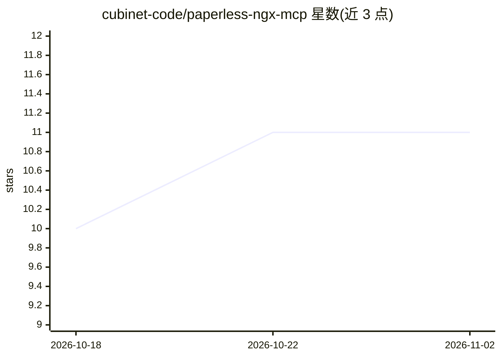

# cubinet-code/paperless-ngx-mcp

⭐ 11 · TypeScript · ISC · 推送 2026-09-30 · [GitHub](https://github.com/cubinet-code/paperless-ngx-mcp) · [官网](https://www.npmjs.com/package/paperless-ngx-mcp) · 组织维护

**让 AI 助手管理 Paperless-NGX 文档库的 MCP 服务器**

以 Model Context Protocol 服务器形式将 Paperless-NGX 3.2 的 REST API 暴露给 AI 助手，工具覆盖 12 个域：文档、标签、往来单位、文档类型、自定义字段、存储路径、保存视图、共享链接、工作流、邮件账户与规则、笔记、回收站与任务。CI 对照 /api/schema/ 校验端点覆盖；破坏性操作（delete、empty_trash、merge）需 confirm:true；提供 triage_inbox 提示词做收件箱整理前确认。经 npx、Docker 镜像、Claude Desktop 扩展或 MCP Registry 安装，需配置 PAPERLESS_URL 与 API key。

## 筛选速览

| 维度 | 判定 | 备注 |
|---|---|---|
| AI 角色 | `ai-ecosystem` | LLM/agent 周边工具 |
| 许可风险 | `permissive` | ISC |
| 部署形态 | `self-host` | docker 或自建部署 |
| 模型依赖 | — | README 未给出锁定关系 |
| 硬件要求 | — | 无带数字的原话,不猜 |
| 安装摩擦 | `low` | 无编译、无系统依赖或容器化 |
| 成熟度 | — | 结构信号不足 |

## 能力要点

- 覆盖 Paperless-NGX REST API 的 12 个域，CI 校验端点完整性
- 破坏性操作需 confirm:true，triage_inbox 先提议后写入
- 动词优先命名便于通配符权限白名单（只读/可写/破坏性分组）
- npx / Docker 多架构镜像 / Claude Desktop 扩展多种安装方式

## 适用场景

- 用 Claude 等 MCP 客户端查询、打标签和整理 Paperless 文档库
- 通过 triage_inbox 流程对收件箱文档批量补充元数据
- 让助手创建工作流自动处理上传文档（如去除 PDF 密码）

## 场景标签

`知识库管理` · 领域:知识与检索

## 证据(README 行号)

> L8: A Model Context Protocol server for Paperless-NGX. Exposes the full Paperless-NGX REST API to AI assistants — docume
> L123: The server registers tools across twelve domains.

## 星数曲线

2026-10-18 10 → 2026-11-02 11（+1）

---
*卡片 v1 · prompt 1.4 · 生成 2026-11-02 · 置信度 high · 依据 README sha `e0eeba9cdd3b` · [字段定义](../../DATASET.md)*
