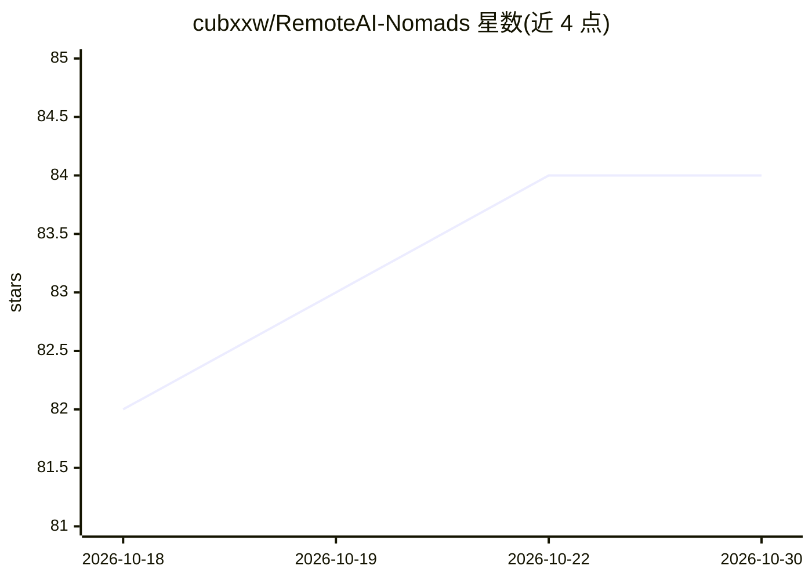

# cubxxw/RemoteAI-Nomads

⭐ 84 · HTML · MIT · 推送 2026-10-29 · [GitHub](https://github.com/cubxxw/RemoteAI-Nomads) · [官网](https://roamorrow.com/nomads) · 个人维护 · 中文 README

**帮中文远程工作者选旅居城市的排行与选城指南**

面向中文数字游民与远程工作者的城市选择内容站：按月更新目的地排行（月花费、舒适度评分、签证便利），提供按预算、免签、网络、安全、气温等条件的筛选榜单；已收录国内14座、国外84座目的地。技术栈为 Cloudflare Workers + D1，助手调用 DeepSeek Flash，可 npm 本地运行演示（公开数据、无需密钥），代码 MIT 许可。内容与数据由维护者整理，欢迎通过 issue 纠错补充。

## 筛选速览

| 维度 | 判定 | 备注 |
|---|---|---|
| AI 角色 | `ai-knowledge` | 知识聚合/清单类 |
| 许可风险 | `permissive` | MIT |
| 部署形态 | `None` |  |
| 模型依赖 | — | README 未给出锁定关系 |
| 硬件要求 | — | 无带数字的原话,不猜 |
| 安装摩擦 | `low` | 无编译、无系统依赖或容器化 |
| 成熟度 | — | 结构信号不足 |

## 能力要点

- 按月花费/舒适度/签证条件组织的城市排行与筛选榜单
- 国内 14 座、国外 84 座目的地资料
- Cloudflare Workers + D1 架构，免费额度内可运行
- 本地演示使用公开数据，无需 Notion 账号或模型密钥

## 适用场景

- 按预算或免签条件查找适合远程工作的城市
- 查看国内目的地当月舒适度与推荐月份
- 对比两城工作条件并获取第一周试住清单

## 场景标签

`精选清单` · 领域:学习与行业

## 证据(README 行号)

> L3: 帮中文远程工作者选城市。打开排行 →
> L22: 已收录14座国内目的地，5座参与评分。按本月舒适度与默认偏好排序，保留未评分资料入口。
> L61: 网站使用 Cloudflare Workers + D1；助手调用 DeepSeek Flash，不需要云容器。网页与数据库可在免费额度内运行，模型调用按量收费。Notion 只留给人写描述和编辑手记。

## 星数曲线

2026-10-18 82 → 2026-10-30 84（+2）

---
*卡片 v1 · prompt 1.4 · 生成 2026-10-24 · 置信度 high · 依据 README sha `93be64d7b1e6` · [字段定义](../../DATASET.md)*
