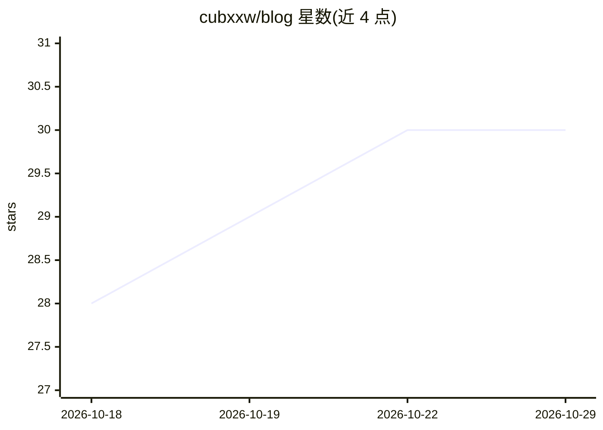

# cubxxw/blog

⭐ 30 · JavaScript · CC0-1.0 · 推送 2026-10-28 · [GitHub](https://github.com/cubxxw/blog) · [官网](https://cubxxw.com/zh) · 个人维护 · 中文 README

**个人博客仓库：AI/Agent 实践、工作流与思考的公开写作现场**

cubxxw 的个人公开写作仓库（cubxxw.com 站点源码），文章围绕三条主线：Agent、上下文、记忆、评测与自动化进入真实生产流程的实践；个人知识管理与内容工作流拆解；以及技术之外的思考与经历。仓库同时公开内容生产系统：写作 Brief、编辑工作流、双语发布、RSS 自动回填 README、自动索引与分发，均由自动化维护。本地可通过 git clone 与 make run 运行。仓库采用 CC0 1.0。

## 筛选速览

| 维度 | 判定 | 备注 |
|---|---|---|
| AI 角色 | `ai-knowledge` | 知识聚合/清单类 |
| 许可风险 | `viral` | CC0-1.0 |
| 部署形态 | `None` |  |
| 模型依赖 | — | README 未给出锁定关系 |
| 硬件要求 | — | 无带数字的原话,不猜 |
| 安装摩擦 | `low` | 无编译、无系统依赖或容器化 |
| 成熟度 | — | 结构信号不足 |

## 能力要点

- 文章沉淀实践、可复用工作流与思考，覆盖 Agent 工程与个人知识系统
- 公开一套内容生产机制：写作 Brief、编辑工作流、双语发布、自动索引分发
- GitHub Actions 从博客 RSS 自动更新 README 最近文章列表
- Hugo 站点，可 git clone 后 make run 本地运行

## 适用场景

- 阅读 AI Agent 工程实践与个人工作流拆解的文章
- 参考其公开的内容生产与自动化分发机制
- 订阅中文/英文 RSS 跟踪更新

## 场景标签

`教程课程` · 领域:学习与行业

## 证据(README 行号)

> L3:  这里不收藏知识。这里公开一个人如何把 AI 变成能力，把经历变成判断，把写作变成长期复利。
> L43: 不止讨论模型和提示词，而是研究 Agent、上下文、记忆、评测、安全边界与自动化，怎样进入真实生产流程。这里保留架构选择，也保留失败现场。
> L92: ```text
> L98: - 最新内容通过 RSS 自动回到 README；站点索引、构建与发布也由自动化持续维护。

## 星数曲线



2026-10-18 28 → 2026-10-29 30（+2）


---
*卡片 v1 · prompt 1.4 · 生成 2026-10-26 · 置信度 high · 依据 README sha `e41b303d97c7` · [字段定义](../../DATASET.md)*
