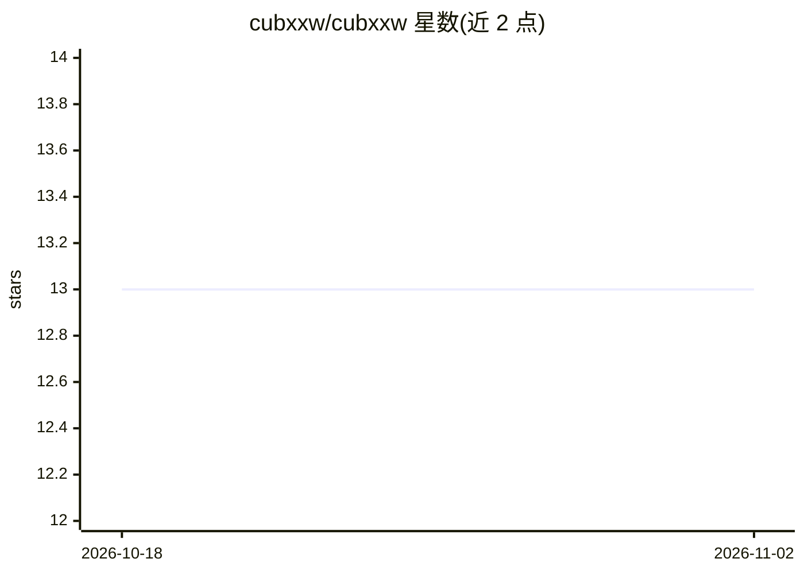

# cubxxw/cubxxw

⭐ 13 · NOASSERTION · 推送 2026-11-01 · [GitHub](https://github.com/cubxxw/cubxxw) · [官网](https://cubxxw.com/) · 个人维护 · 中文 README

**个人开发者主页 README：展示 AI 产品、开源贡献与写作**

这是 Xinwei Xiong（cubxxw）的 GitHub 个人主页配置仓库，README 展示其身份（AI 产品构建者、OpenIM 核心贡献者、数字游民）、正在构建的四个产品（Telepace 语音 AI 客户调研基础设施、Apply Agent 求职副驾、Solo Compass、DayPage）、开源贡献、双语博客文章列表与联系方式。仓库本身为个人主页 markdown 配置，不提供可安装的软件。

## 筛选速览

| 维度 | 判定 | 备注 |
|---|---|---|
| AI 角色 | `ai-knowledge` | 知识聚合/清单类 |
| 许可风险 | `none` | NOASSERTION |
| 部署形态 | `self-host` | docker 或自建部署 |
| 模型依赖 | — | README 未给出锁定关系 |
| 硬件要求 | — | 无带数字的原话,不猜 |
| 安装摩擦 | `low` | 无编译、无系统依赖或容器化 |
| 成熟度 | — | 结构信号不足 |

## 能力要点

- 展示 4 个公开构建中的 AI 产品（Telepace/Apply Agent/Solo Compass/DayPage）
- OpenIM 核心贡献者与 Sealos 贡献者身份展示
- 双语（英文/中文）博客文章与 RSS 更新列表

## 适用场景

- 了解 cubxxw 的 AI 产品与项目动态
- 通过链接联系或求职（Telepace 招聘信息）
- 追踪其开源贡献与写作

## 场景标签

 · 领域:个人主页/README Profile

## 证据(README 行号)

> L1: Xinwei Xiong (cubxxw) — AI Builder, Open Source Contributor, Digital Nomad
> L8: **Xinwei Xiong** (熊鑫伟, aka **cubxxw**, b. 2001) is an AI product builder and open-source contributor from China, run

## 星数曲线

2026-10-18 13 → 2026-11-02 13（+0）

---
*卡片 v1 · prompt 1.4 · 生成 2026-10-31 · 置信度 mid · 依据 README sha `849c6e3a9e1d` · [字段定义](../../DATASET.md)*
