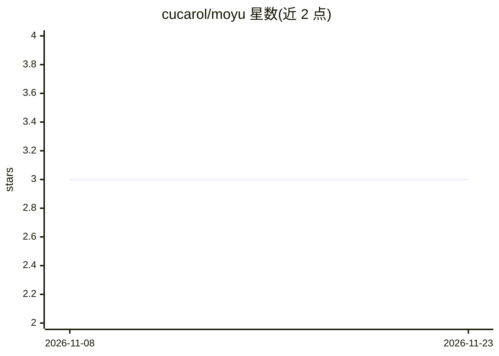

# cucarol/moyu

⭐ 3 · JavaScript · MIT · 推送 2026-11-05 · [GitHub](https://github.com/cucarol/moyu) · 个人维护 · 中文 README

**让 AI agent 在 3D 像素牌桌上自动与你玩游戏的插件**

moyu（意为"摸鱼"）是 Claude Code / DeepSeek Harness 的插件：用户说一句"来玩个游戏"，agent 开启牌桌并给出链接，用户在浏览器 3D 像素桌面对局，agent 自动操作自己的座位，无需持续提示或报"该你了"。内置三款游戏：轮盘赌（含 AI 梗道具）、21 点、快艇骰子；支持持续房间与聊天，页面支持 10 种语言。公平性由服务端密钥种子 + sha256 承诺 + 游戏后 seed 揭示回放验证保障；agent 只能通过玩家相同命令看到自己的座位。需 Node.js 22+ 和浏览器，服务器本地监听 127.0.0.1，闲置 10 分钟自动停止。

## 筛选速览

| 维度 | 判定 | 备注 |
|---|---|---|
| AI 角色 | `ai-enhanced` | 去掉 AI 部分产品仍成立 |
| 许可风险 | `permissive` | MIT |
| 部署形态 | `None` |  |
| 模型依赖 | locked-api |  |
| 硬件要求 | — | 无带数字的原话,不猜 |
| 安装摩擦 | `low` | 无编译、无系统依赖或容器化 |
| 成熟度 | — | 结构信号不足 |

## 能力要点

- agent 全自动操作自己的座位，无需提示或"该你了"
- seed 承诺-揭示机制与 moyu verify 回放验证公平性
- 三款游戏 + 持续房间，页面支持 10 种语言
- 游戏道具含 AI 梗（Prompt Injection / 429 / Hallucination 等）

## 适用场景

- 和 Claude Code 或 DeepSeek agent 在浏览器里休闲对局
- 与 agent 保持一个常开房间，边聊边开新游戏
- 游戏结束后验证发牌是否被操纵

## 场景标签

 · 领域:游戏/娱乐工具

## 证据(README 行号)

> L11: Say "let's play a game" and your agent opens a table and gives you a link. You play in the browser, at a 3D pixel t
> L13: It's fully automatic: after that one line you never have to prompt it, and never tell it "your turn". Every move yo
> L41: moyu needs Node.js 22 or later and a browser.

## 星数曲线

2026-11-08 3 → 2026-11-23 3（+0）

---
*卡片 v1 · prompt 1.4 · 生成 2026-11-22 · 置信度 high · 依据 README sha `8f55d9365162` · [字段定义](../../DATASET.md)*
