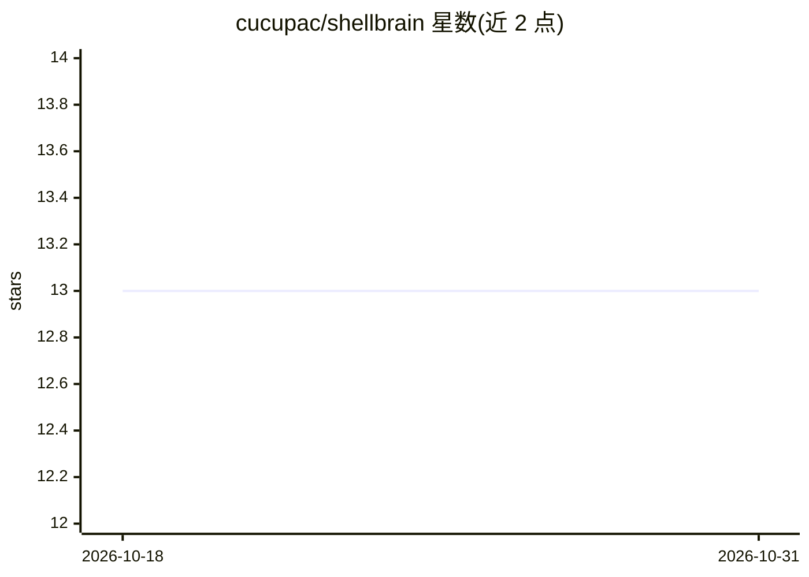

# cucupac/shellbrain

⭐ 13 · Python · 推送 2026-09-24 · [GitHub](https://github.com/cucupac/shellbrain) · [官网](https://shellbrain.ai) · 个人维护

**给编码 agent 提供长期记忆的 CLI 工具**

ShellBrain 是面向软件工程 AI agent 的长期记忆工具：以案例推理和自管理概念图为核心，存储情节记忆（提示/响应/工具调用）、案例记忆（问题与解决方案）与概念图三类知识，记忆与代码证据直接关联。agent 通过 `shellbrain recall` 命令检索记忆，结合 BM25、向量相似度与图关联，并由内部 recall agent 汇总结果；可切换 recall provider（codex/claude/inception，Inception 需 API key）。适用于 Codex、Claude Code 与 Cursor。

## 筛选速览

| 维度 | 判定 | 备注 |
|---|---|---|
| AI 角色 | `ai-ecosystem` | LLM/agent 周边工具 |
| 许可风险 | `none` | — |
| 部署形态 | `None` |  |
| 模型依赖 | — | README 未给出锁定关系 |
| 硬件要求 | — | 无带数字的原话,不猜 |
| 安装摩擦 | `low` | 无编译、无系统依赖或容器化 |
| 成熟度 | — | 结构信号不足 |

## 能力要点

- 三类长期记忆：情节记忆、案例记忆、概念图，且关联代码证据
- recall 同时结合 BM25、向量相似度与图关联检索
- 支持切换 recall provider（codex/claude/inception）
- 声明适配 Codex、Claude Code、Cursor

## 适用场景

- 让 Claude Code/Codex/Cursor 等 agent 在任务间保留和复用经验
- 通过命令行检索过往问题解决方案与失败尝试
- 为编码 agent 构建关联代码证据的知识库

## 场景标签

`Agent 记忆` · 领域:Agent 开发

## 证据(README 行号)

> L7: ShellBrain uses case-based reasoning and a self-managing concept graph as long-term memory for software engineering.
> L44: Working agents run `shellbrain recall` for long-term memory related to their current task.

## 星数曲线

2026-10-18 13 → 2026-10-31 13（+0）

---
*卡片 v1 · prompt 1.4 · 生成 2026-10-31 · 置信度 high · 依据 README sha `ad0482f5e4d5` · [字段定义](../../DATASET.md)*
