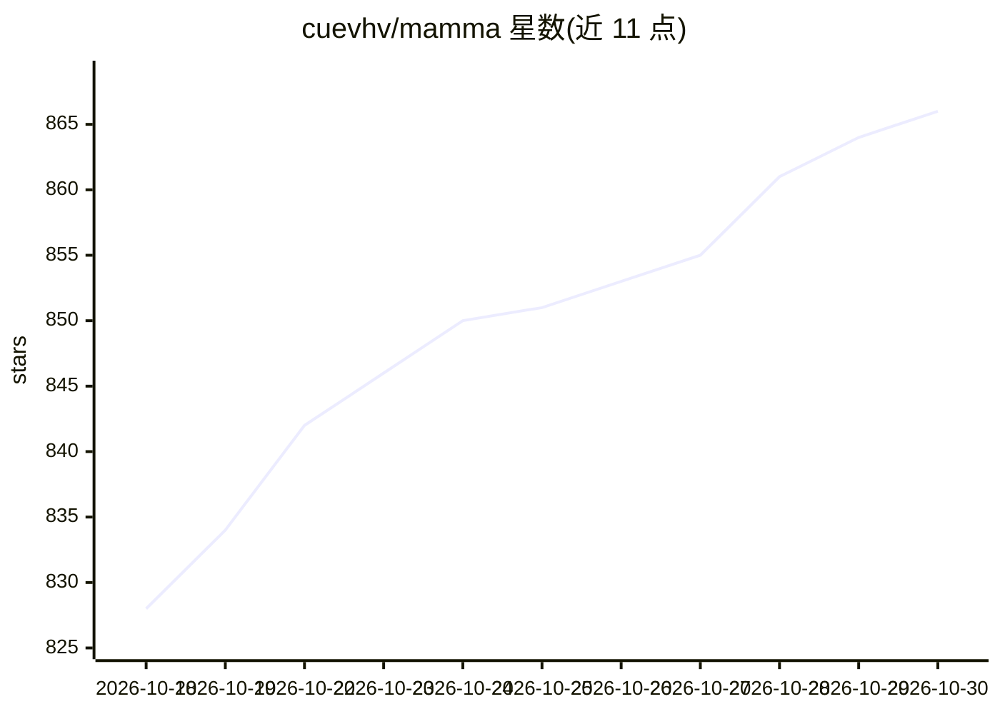

# cuevhv/mamma

⭐ 866 · Python · NOASSERTION · 推送 2026-10-27 · [GitHub](https://github.com/cuevhv/mamma) · [官网](https://mamma.is.tue.mpg.de/) · 组织维护

**多视角多人无标记动作捕捉研究代码（CVPR 2026）**

CVPR 2026 论文 MAMMA 的官方代码，提供推理与训练两部分：从多相机视频出发，经逐人分割（SAM+YOLO）、2D 关键点检测（MammaNet）、多视角 SMPL-X 优化，输出 3D 人体姿态。支持自备素材运行，需标定文件与预设配置；附浏览器 GUI（Flask+Vite）、环境检查 doctor 命令与示例序列。论文数据集需在项目页注册账号下载，许可限于非商业科研用途。

## 筛选速览

| 维度 | 判定 | 备注 |
|---|---|---|
| AI 角色 | `ai-native` | 本体是模型或模型工具 |
| 许可风险 | `none` | NOASSERTION |
| 部署形态 | `None` |  |
| 模型依赖 | — | README 未给出锁定关系 |
| 硬件要求 | — | 无带数字的原话,不猜 |
| 安装摩擦 | `medium` | 含编译或系统依赖之一 |
| 成熟度 | — | 结构信号不足 |

## 能力要点

- 五步流水线：ma_cap→ma_masks→ma_2d→ma_3d→ma_vis
- 逐人分割采用 SAM+YOLO，2D 检测使用 MammaNet，3D 为多视角 SMPL-X 优化
- 提供浏览器 GUI 与环境检查命令（inference doctor）
- 发布五类数据集：dance/multi-person/iPhone/eval/synthetic

## 适用场景

- 用自己的多相机素材做无标记多人动作捕捉
- 复现论文实验或在其数据集上评测
- 研究人体姿态估计与 SMPL-X 优化方法

## 场景标签

`科研工具` · 领域:学习与行业

## 证据(README 行号)

> L1: # MAMMA: Markerless Accurate Multi-person Motion Acquisition
> L60: |`ma_masks`|Per-person segmentation (SAM + YOLO)|
> L61: |`ma_2d`|2D landmark detection (MammaNet)|
> L62: |`ma_3d`|Multi-view SMPL-X optimization|

## 星数曲线

2026-10-18 828 → 2026-10-30 866（+38）

---
*卡片 v1 · prompt 1.4 · 生成 2026-10-21 · 置信度 high · 依据 README sha `22bc57b1b05c` · [字段定义](../../DATASET.md)*
