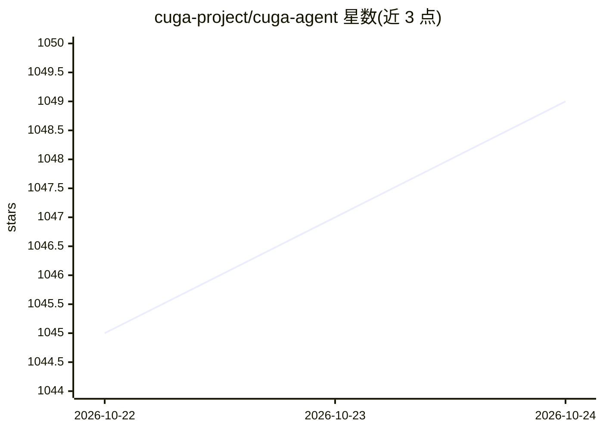

# cuga-project/cuga-agent

⭐ 1,049 · Python · Apache-2.0 · 推送 2026-10-23 · [GitHub](https://github.com/cuga-project/cuga-agent) · [官网](https://cuga.dev) · 组织维护

**面向企业的通用 agent 运行框架：策略管控地执行业务任务**

Apache 2.0 开源的企业 agent harness：把业务请求转化为跨应用、API、浏览器与文档的操作。支持私有云或离线环境部署，可接入 OpenAI 兼容私有推理端点与开放模型。机制包括五种执行策略（Intent Guard、Playbook、Tool Approval、Tool Guide、Output Formatter）、MCP/OpenAPI/Python 工具接入、CugaSupervisor 多 agent 编排、SKILL.md 技能复用、事件服务定时/触发式自动化、Evolve 记忆后端。提供 CLI、Python SDK 与 Kubernetes Helm 部署；事件服务与 Evolve 记忆需单独部署配置，记忆持久化需 PostgreSQL。

## 筛选速览

| 维度 | 判定 | 备注 |
|---|---|---|
| AI 角色 | `ai-ecosystem` | LLM/agent 周边工具 |
| 许可风险 | `permissive` | Apache-2.0 |
| 部署形态 | `library` | 以包/库形式分发 |
| 模型依赖 | — | README 未给出锁定关系 |
| 硬件要求 | — | 无带数字的原话,不猜 |
| 安装摩擦 | `low` | 无编译、无系统依赖或容器化 |
| 成熟度 | — | 结构信号不足 |

## 能力要点

- 五种策略类型：意图拦截、Playbook、工具审批、ToolGuard、输出格式化
- 接入 MCP 服务器、OpenAPI 服务与 Python 工具，支持私有 OpenAI 兼容推理端点
- CugaSupervisor 多 agent 编排与事件服务定时/触发自动化
- 支持私有云、Kubernetes 与离线环境部署，提供 run receipt 的 token/调用统计

## 适用场景

- 在私有环境中部署执行企业业务流程的 agent 并配置审批与护栏
- 把 CRM、文档等系统接入 agent 完成报表与知识问答工作流
- 通过事件服务定时或按事件触发自动化任务

## 场景标签

`Agent 框架` `多智能体` `工作流自动化` · 领域:Agent 开发

## 证据(README 行号)

> L5: **The enterprise agent harness for sovereign, policy-controlled automation.**
> L7: CUGA turns business requests into actions across your applications, APIs, and documents. Deploy in your private clou
> L41: |**Faster delivery**|Connect MCP servers, OpenAPI services, and Python tools. Configure and test an agent in the UI

## 星数曲线

2026-10-22 1,045 → 2026-10-24 1,049（+4）

---
*卡片 v1 · prompt 1.4 · 生成 2026-10-21 · 置信度 high · 依据 README sha `eef7503621ac` · [字段定义](../../DATASET.md)*
