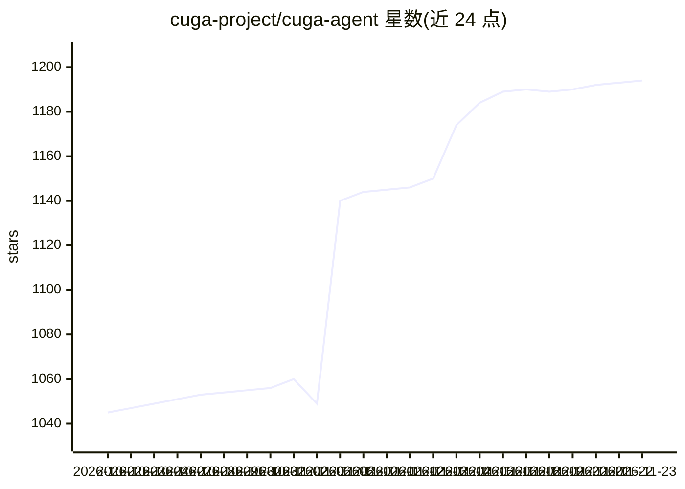

# cuga-project/cuga-agent

⭐ 1,194 · Python · Apache-2.0 · 推送 2026-11-22 · [GitHub](https://github.com/cuga-project/cuga-agent) · [官网](https://cuga.dev) · 组织维护 · 中文 README

**企业级通用 agent 框架：将业务请求转为应用/API 操作**

CUGA 是一个面向企业的开源通用 agent 框架（harness），把业务请求转换为跨应用、API 和文档的操作。支持连接 MCP 服务器、OpenAPI 服务与 Python 工具，通过 UI 或 Python SDK 配置五种执行策略（Intent Guard、Playbook、Tool Approval、Tool Guide、Output Formatter）实现意图拦截、人工审批与工具级守卫。提供多 agent 协调（CugaSupervisor）、SKILL.md 技能复用、事件服务定时触发、记忆（Evolve）检索与执行轨迹可视化（cuga viz）。部署方式覆盖本地/私有云、Kubernetes（Helm）与气隙环境，可指向 OpenAI 兼容的私有推理端点。

## 筛选速览

| 维度 | 判定 | 备注 |
|---|---|---|
| AI 角色 | `ai-ecosystem` | LLM/agent 周边工具 |
| 许可风险 | `permissive` | Apache-2.0 |
| 部署形态 | `library` | 以包/库形式分发 |
| 模型依赖 | — | README 未给出锁定关系 |
| 硬件要求 | — | 无带数字的原话,不猜 |
| 安装摩擦 | `low` | 无编译、无系统依赖或容器化 |
| 成熟度 | — | 结构信号不足 |

## 能力要点

- 五种策略类型实现意图拦截、人工审批与工具级守卫
- MCP、OpenAPI 与 Python 工具接入及 CugaSupervisor 多 agent 协调
- 气隙部署支持：预置模型工件与本地推理端点配置
- 运行回执记录 token、模型调用、工具调用与耗时

## 适用场景

- 在私有云内将 CRM、文档等业务请求自动化为工具调用流程
- 为敏感工具配置审批与守卫策略后再发布 agent 版本
- 用事件服务把周期性报告类请求配置为定时或触发式工作流
- 通过 Python SDK 在自有应用中嵌入 agent 调用

## 场景标签

`Agent 框架` `多智能体` `Agent 记忆` `GUI 自动化` · 领域:Agent 开发

## 证据(README 行号)

> L5: **The enterprise agent harness for sovereign, policy-controlled automation.**
> L7: CUGA turns business requests into actions across your applications, APIs, and documents. Deploy in your private clou
> L224: ## Build with the Python SDK

## 星数曲线

2026-10-22 1,045 → 2026-11-23 1,194（+149）

---
*卡片 v1 · prompt 1.4 · 生成 2026-11-23 · 置信度 high · 依据 README sha `d7d3f99488d8` · [字段定义](../../DATASET.md)*
