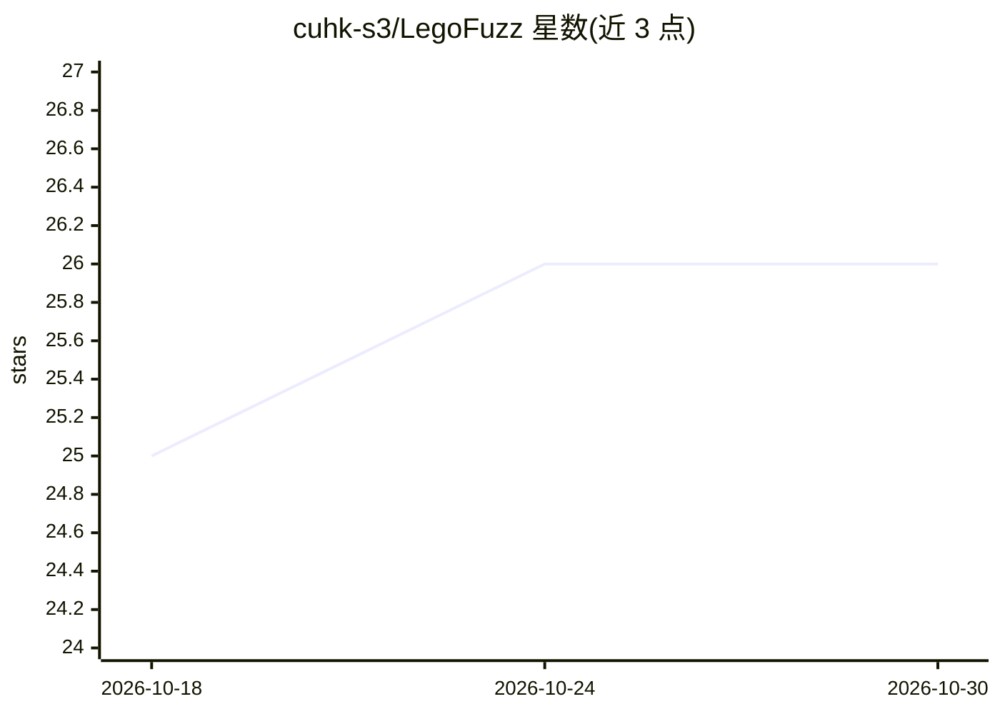

# cuhk-s3/LegoFuzz

⭐ 26 · C · Apache-2.0 · 推送 2025-12-14 · [GitHub](https://github.com/cuhk-s3/LegoFuzz) · 组织维护

**用 LLM 生成 C 函数块对 GCC/LLVM 编译器做模糊测试的框架**

面向 C 编译器测试的 LLM 模糊测试框架。离线阶段调用 LLM（支持 OpenAI、TogetherAI、DeepSeek 三种 API）生成与真实代码风格对齐的有效 C 函数块，分析其属性并构建函数数据库；在线阶段不依赖 LLM，通过迭代程序合成复用预生成函数块，拼装复杂程序并在不同编译器及优化级别下编译运行、比对输出以检测不一致并报告编译器缺陷。项目部分基于 Creal，提供 setup.sh 自动化安装，已发现 GCC 与 LLVM 的真实编译器 bug。

## 筛选速览

| 维度 | 判定 | 备注 |
|---|---|---|
| AI 角色 | `ai-ecosystem` | LLM/agent 周边工具 |
| 许可风险 | `permissive` | Apache-2.0 |
| 部署形态 | `None` |  |
| 模型依赖 | locked-api |  |
| 硬件要求 | — | 无带数字的原话,不猜 |
| 安装摩擦 | `medium` | 含编译或系统依赖之一 |
| 成熟度 | — | 结构信号不足 |

## 能力要点

- 离线 LLM 生成代码块 + 在线无 LLM 的两阶段测试流程
- 迭代程序合成：从函数数据库拼装复杂有效程序
- 同一程序在不同编译器/优化级别下比对输出检测不一致
- buglist/ 目录收录已发现的 GCC/LLVM 编译器 bug

## 适用场景

- 为 GCC/LLVM 编译器挖掘编译缺陷
- 利用 LLM 生成贴近真实代码模式的测试种子
- 研究基于 LLM 的编译器模糊测试方法

## 场景标签

`代码生成` · 领域:编码与开发

## 证据(README 行号)

> L12: **LegoFuzz** is an LLM-based fuzzing framework. It currently supports testing C compilers, such as GCC and LLVM.
> L16: > The offline phase queries LLMs to collect valid code snippets, which enables us to control the quality of code as
> L17: > In contrast, the online phase eliminates the dependency on LLMs by **reusing** these pre-generated code snippets.

## 星数曲线

2026-10-18 25 → 2026-10-30 26（+1）

---
*卡片 v1 · prompt 1.4 · 生成 2026-10-26 · 置信度 high · 依据 README sha `1982dc328584` · [字段定义](../../DATASET.md)*
