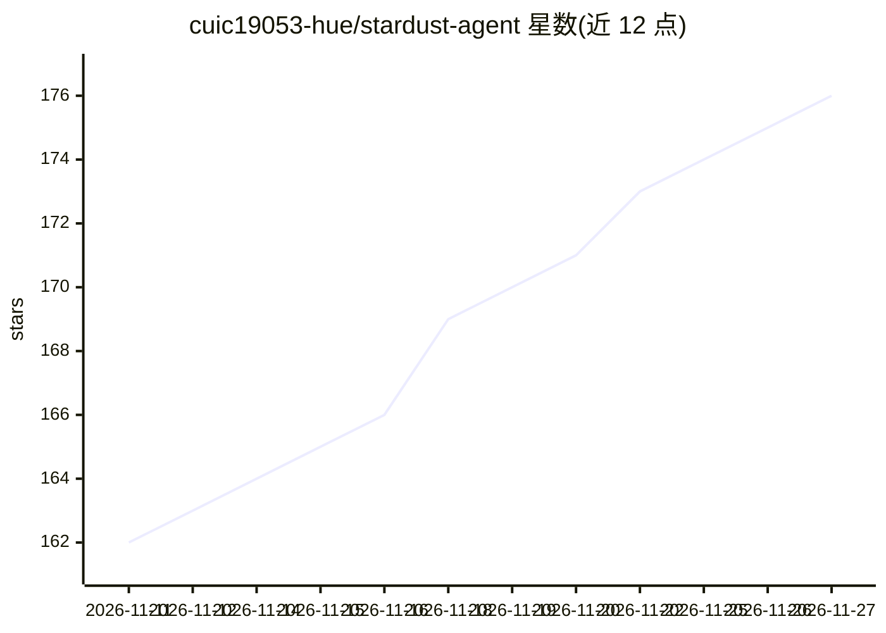

# cuic19053-hue/stardust-agent

⭐ 176 · Python · MIT · 推送 2026-11-26 · [GitHub](https://github.com/cuic19053-hue/stardust-agent) · [官网](https://agent.stardust.website) · 组织维护 · 中文 README

**面向大学生的申报材料 AI 起草与逐章编辑工作台**

基于 Python 与 FastAPI 的开源 AI Agent 工作台，覆盖大创、挑战杯、商业计划书、奖学金、保研、三下乡等 35 个申报场景。用户上传学校通知与个人材料，Agent 经 RAG 检索依据、起草章节草稿，支持逐章编辑与 Word 导出；提供 41 字段的口述信息提取与来源校验、六类草稿预审规则检查。支持在线工作台、本地部署与 MCP 接入；各赛道的模型写作、模板与导出支持程度不同，端到端验收尚未完成。MIT 许可，附免责声明。

## 筛选速览

| 维度 | 判定 | 备注 |
|---|---|---|
| AI 角色 | `ai-native` | 本体是模型或模型工具 |
| 许可风险 | `permissive` | MIT |
| 部署形态 | `None` |  |
| 模型依赖 | local-ok | 支持本地模型 |
| 硬件要求 | — | 无带数字的原话,不猜 |
| 安装摩擦 | `low` | 无编译、无系统依赖或容器化 |
| 成熟度 | — | 结构信号不足 |

## 能力要点

- 35 个申报场景的领域指南（Skills）与 Word 样例
- 41 字段口述提取，每条附对话回合与学生原话来源校验
- RAG 检索结合关键词与向量，返回来源文件和段落位置
- 支持 Ollama 本地模型、OpenAI 兼容接口与 MCP 客户端接入

## 适用场景

- 整理大创/挑战杯申报书并让 Agent 检索依据、起草章节
- 把个人口述的成绩经历整理成可逐项核对的结构化档案
- 草稿提交前做预算冲突、无依据成果等预审检查
- 从 Codex/Cursor 等 MCP 客户端连接本地项目工具

## 场景标签

`RAG` `AI 写作` · 领域:内容生成

## 证据(README 行号)

> L5: **大学生申报材料（申报书、申请书、商业计划书、实践报告、个人陈述）一站式工作台。**
> L7: **Stardust Agent** 是面向大学生的开源 AI Agent 工作台，帮助整理大创申报书、挑战杯申报书、中国国际大学生创新大赛商业计划书、奖学金申请书、保研材料和三下乡实践材料。学生可以在项目中整理学校通知和已有资料，
> L73: |回答里的材料从哪里来？|项目资料经用户确认后分段索引。RAG 检索结合关键词和可用的同版本向量，返回来源文件和段落位置。官方通知另按学校、年度和适用范围查找。|项目检索 · 知识来源与覆盖|

## 星数曲线

2026-11-11 162 → 2026-11-27 176（+14）

---
*卡片 v1 · prompt 1.4 · 生成 2026-11-26 · 置信度 high · 依据 README sha `eed170512d9d` · [字段定义](../../DATASET.md)*
