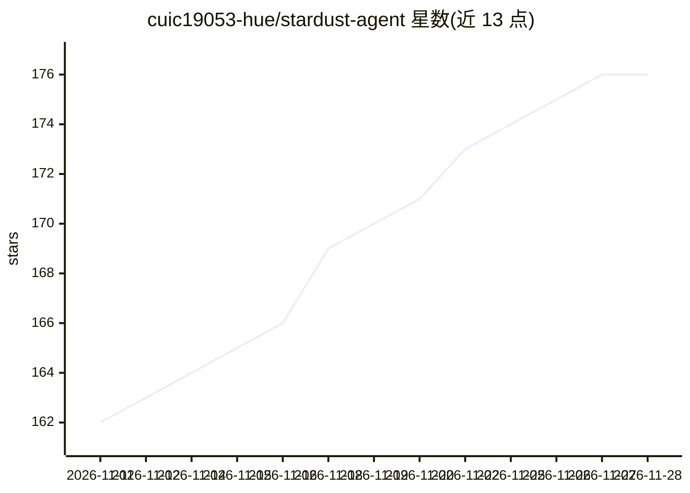

# cuic19053-hue/stardust-agent

⭐ 176 · Python · MIT · 推送 2026-11-27 · [GitHub](https://github.com/cuic19053-hue/stardust-agent) · [官网](https://agent.stardust.website) · 组织维护 · 中文 README

**大学生的申报材料 AI 工作台：检索依据、起草并导出 Word**

面向大学生的开源 AI Agent 工作台，覆盖大创、挑战杯、奖学金、保研、三下乡等 35 类申报场景。学生在项目里上传学校通知与个人资料，Agent 经 RAG 检索项目内已确认材料并协助起草，支持逐章编辑后导出 Word。后端 Python/FastAPI，支持工具调用（单轮最多 6 次迭代、8 次工具预算）、MCP 接入；提供在线工作台、桌面客户端、本地部署三种形态，另含微调 Qwen2.5 端侧浏览器口述提取与预审评测脚本。README 明确未完成全部场景端到端验收，且不承诺申报结果。

## 筛选速览

| 维度 | 判定 | 备注 |
|---|---|---|
| AI 角色 | `ai-native` | 本体是模型或模型工具 |
| 许可风险 | `permissive` | MIT |
| 部署形态 | `None` |  |
| 模型依赖 | local-ok | 支持本地模型 |
| 硬件要求 | — | 无带数字的原话,不猜 |
| 安装摩擦 | `low` | 无编译、无系统依赖或容器化 |
| 成熟度 | `idea` | |

## 能力要点

- 35 个申报场景以 Skills 形式提供领域指南
- RAG 检索结合关键词与同版本向量，返回来源文件和段落位置
- 微调 Qwen2.5-0.5B 经 WebGPU 在浏览器本地提取口述，无需 API Key
- MCP server 支持 Codex/Cursor 等客户端连接项目工具

## 适用场景

- 整理大创、挑战杯等申报书的结构与佐证材料
- 把口述的经历整理成结构化档案供申报引用
- 将对话草稿逐章编辑后导出 Word 交学校模板核对

## 场景标签

`RAG` `AI 写作` `微调` · 领域:内容生成

## 证据(README 行号)

> L7: **Stardust Agent** 是面向大学生的开源 AI Agent 工作台，帮助整理大创申报书、挑战杯申报书、中国国际大学生创新大赛商业计划书、奖学金申请书、保研材料和三下乡实践材料。学生可以在项目中整理学校通知和已有资料，
> L9: 项目提供 35 个领域指南。后端使用 Python 和 FastAPI，支持 Ollama 本地模型和 OpenAI 兼容接口。这里的覆盖指指南与赛道目录，各赛道的模型写作、模板、图表和导出支持程度不同，尚未完成全部场景的端到端验收
> L92: |模型怎样选工具，何时结束？|同步答复与 SSE 流式答复共用对话循环。一轮对话最多迭代 6 次，工具调用预算为 8 次。服务端执行前再次检查工具授权，并绑定当前项目。|运行时 · 工具路由|

## 星数曲线

2026-11-11 162 → 2026-11-28 176（+14）

---
*卡片 v1 · prompt 1.4 · 生成 2026-11-27 · 置信度 high · 依据 README sha `5476ffcbcde8` · [字段定义](../../DATASET.md)*
