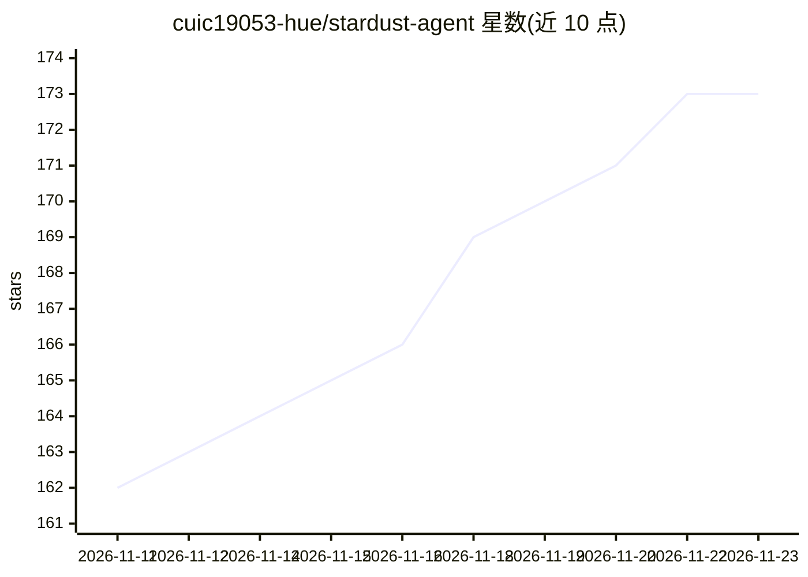

# cuic19053-hue/stardust-agent

⭐ 173 · Python · MIT · 推送 2026-11-22 · [GitHub](https://github.com/cuic19053-hue/stardust-agent) · [官网](https://agent.stardust.website) · 组织维护 · 中文 README

**大学生申报材料（申报书/商业计划书等）一站式 AI 写作工作台**

面向大学生的开源 AI Agent 工作台，覆盖大创、挑战杯、奖学金、保研、三下乡等 35 个申报场景，以 Skills 形式提供领域指南。学生上传学校通知等资料并确认后，Agent 通过 RAG 检索依据协助起草，支持逐章编辑并导出 Word。后端为 Python/FastAPI，支持 Ollama 本地模型和 OpenAI 兼容接口，另提供在线工作台与 MCP 接入（stdio）。README 声明各赛道支持程度不同、真实范文授权数为 0，生成内容真实性由使用者负责。

## 筛选速览

| 维度 | 判定 | 备注 |
|---|---|---|
| AI 角色 | `ai-native` | 本体是模型或模型工具 |
| 许可风险 | `permissive` | MIT |
| 部署形态 | `None` |  |
| 模型依赖 | local-ok | 支持本地模型 |
| 硬件要求 | — | 无带数字的原话,不猜 |
| 安装摩擦 | `low` | 无编译、无系统依赖或容器化 |
| 成熟度 | `idea` | |

## 能力要点

- 35 个申报场景领域指南（Skills 形式）
- RAG 检索项目资料辅助起草，逐章编辑后导出 Word
- 支持 Ollama 本地模型与 OpenAI 兼容接口
- 提供 MCP Server，可从 Codex/Cursor 等 MCP 客户端连接

## 适用场景

- 整理大创/挑战杯申报材料并起草申报书
- 准备奖学金申请书、保研个人陈述等材料
- 上传学校通知让 Agent 检索依据后逐章成稿导出 Word

## 场景标签

`RAG` `AI 写作` · 领域:内容生成

## 证据(README 行号)

> L7: **Stardust Agent** 是面向大学生的开源 AI Agent 工作台，帮助整理大创申报书、挑战杯申报书、中国国际大学生创新大赛商业计划书、奖学金申请书、保研材料和三下乡实践材料。学生可以在项目中整理学校通知和已有资料，
> L61: |聊天怎样变成 Word？|学生从对话中预览并选取章节草稿，编辑后保存。导出使用项目里已保存的正文，提交前仍可核对学校模板和引用。|对话草稿 · Word 导出|

## 星数曲线

2026-11-11 162 → 2026-11-23 173（+11）

---
*卡片 v1 · prompt 1.4 · 生成 2026-11-17 · 置信度 high · 依据 README sha `8dbb477b669d` · [字段定义](../../DATASET.md)*
