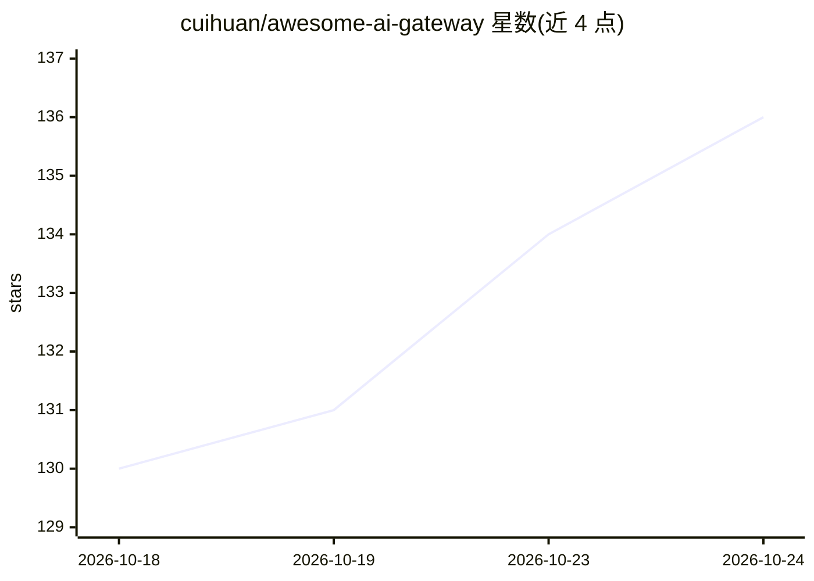

# cuihuan/awesome-ai-gateway

⭐ 136 · HTML · CC0-1.0 · 推送 2026-10-23 · [GitHub](https://github.com/cuihuan/awesome-ai-gateway) · [官网](https://cuihuan.github.io/awesome-ai-gateway/) · 个人维护 · 中文 README

**180+ AI 网关选型清单：决策树+手册+可复现成本基准**

面向为 LLM 应用挑选 AI 网关的工程师的策展清单：以决策树在托管（OpenRouter/Vercel/Cloudflare/Azure 等）与自托管开源（LiteLLM/Bifrost/new-api/Kong/Higress 等）180+ 网关中按成本、合规、可观测性等需求选型；提供 8 章手册讲解网关的路由、故障转移、缓存经济学、虚拟密钥计量与 MCP/agent 流量机制；成本数据由单元测试脚本从开放定价数据计算，stars 每日经 CI 刷新，标注 2026 年项目归档与并购动态。CC0 许可，声明无厂商赞助。

## 筛选速览

| 维度 | 判定 | 备注 |
|---|---|---|
| AI 角色 | `ai-knowledge` | 知识聚合/清单类 |
| 许可风险 | `viral` | CC0-1.0 |
| 部署形态 | `library` | 以包/库形式分发 |
| 模型依赖 | — | README 未给出锁定关系 |
| 硬件要求 | — | 无带数字的原话,不猜 |
| 安装摩擦 | `low` | 无编译、无系统依赖或容器化 |
| 成熟度 | — | 结构信号不足 |

## 能力要点

- 决策树按需求（成本/合规/K8s/MCP 等）在 180+ 网关中选型
- 8 章手册覆盖路由、故障转移、缓存经济学、计量与 MCP 网关
- 成本单元格由单元测试脚本计算，106× 模型价差数据可复现
- 跟踪归档/停更项目与 2026 年并购动态并标注风险

## 适用场景

- 为团队挑选托管或自托管 AI 网关
- 了解网关在故障转移、缓存、计量上的实际机制
- 对比模型路由成本以降低 token 开销

## 场景标签

`精选清单` · 领域:学习与行业

## 证据(README 行号)

> L8: > **Pick one in ~10 seconds, understand why, and check every number yourself.** A decision tree over 180+ gateways, 
> L26:  Decision tree: which AI gateway should you use? Hosted (OpenRouter, Vercel, Cloudflare, Bedrock, Azure, Vertex, Po
> L59: > **Why this matters:** the same task can cost **100× more** depending on the model behind your gateway. An **AI ga

## 星数曲线

2026-10-18 130 → 2026-10-24 136（+6）

---
*卡片 v1 · prompt 1.4 · 生成 2026-10-23 · 置信度 mid · 依据 README sha `279926b1beab` · [字段定义](../../DATASET.md)*
