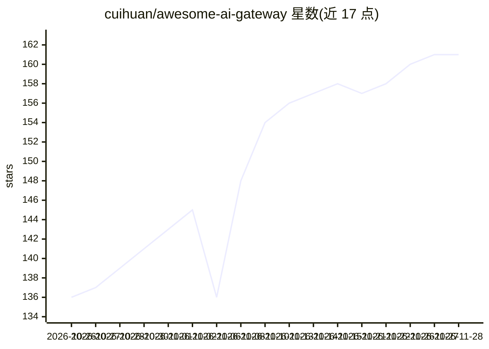

# cuihuan/awesome-ai-gateway

⭐ 161 · HTML · CC0-1.0 · 推送 2026-11-27 · [GitHub](https://github.com/cuihuan/awesome-ai-gateway) · [官网](https://cuihuan.github.io/awesome-ai-gateway/) · 个人维护 · 中文 README

**面向开发者的 AI 网关选型清单：240+ 选项决策树与成本基准**

一份关于 AI 网关（API 网关）的开源知识清单：提供覆盖 240+ 网关（托管与自托管）的决策树，按成本、路由、合规、可观测性等需求给出推荐起点；收录 2026 年行业整合时间线（TensorZero 归档、OpenRouter 被 Stripe 收购等）、8 章讲解网关工作原理的手册，以及可复现的成本与延迟基准（附带日期化证据）。支持英语与简体中文双语，CC0 许可，声明无厂商赞助。

## 筛选速览

| 维度 | 判定 | 备注 |
|---|---|---|
| AI 角色 | `ai-knowledge` | 知识聚合/清单类 |
| 许可风险 | `viral` | CC0-1.0 |
| 部署形态 | `library` | 以包/库形式分发 |
| 模型依赖 | — | README 未给出锁定关系 |
| 硬件要求 | — | 无带数字的原话,不猜 |
| 安装摩擦 | `low` | 无编译、无系统依赖或容器化 |
| 成熟度 | — | 结构信号不足 |

## 能力要点

- 240+ 网关的决策树：按需求（路由、成本、合规、K8s、MCP）选择起点
- 8 章手册讲解网关路由、缓存、故障转移、计量等机制
- 可复现的成本与延迟基准，数字由单元测试脚本计算
- 2026 年行业整合时间线与 CC0、无厂商赞助声明

## 适用场景

- 为自托管或托管网关选型（LiteLLM、Bifrost、Kong、Higress 等）
- 需要中文模型与团队计费时参考 new-api 等方案
- 查阅网关延迟开销、缓存折扣、数据保留政策的实测数据

## 场景标签

`精选清单` · 领域:学习与行业

## 证据(README 行号)

> L8: > **Pick one in ~10 seconds, understand why, and check every number yourself.** A decision tree over 240+ gateways, 
> L28:  Decision tree: which AI gateway should you use? Hosted (OpenRouter, Vercel, Cloudflare, Bedrock, Azure, Vertex, Po
> L103: _The list tells you **which** gateway; these chapters teach you **how they work and why they fail** — same evidenc

## 星数曲线

2026-10-26 136 → 2026-11-28 161（+25）

---
*卡片 v1 · prompt 1.4 · 生成 2026-11-28 · 置信度 mid · 依据 README sha `fa16b439b937` · [字段定义](../../DATASET.md)*
