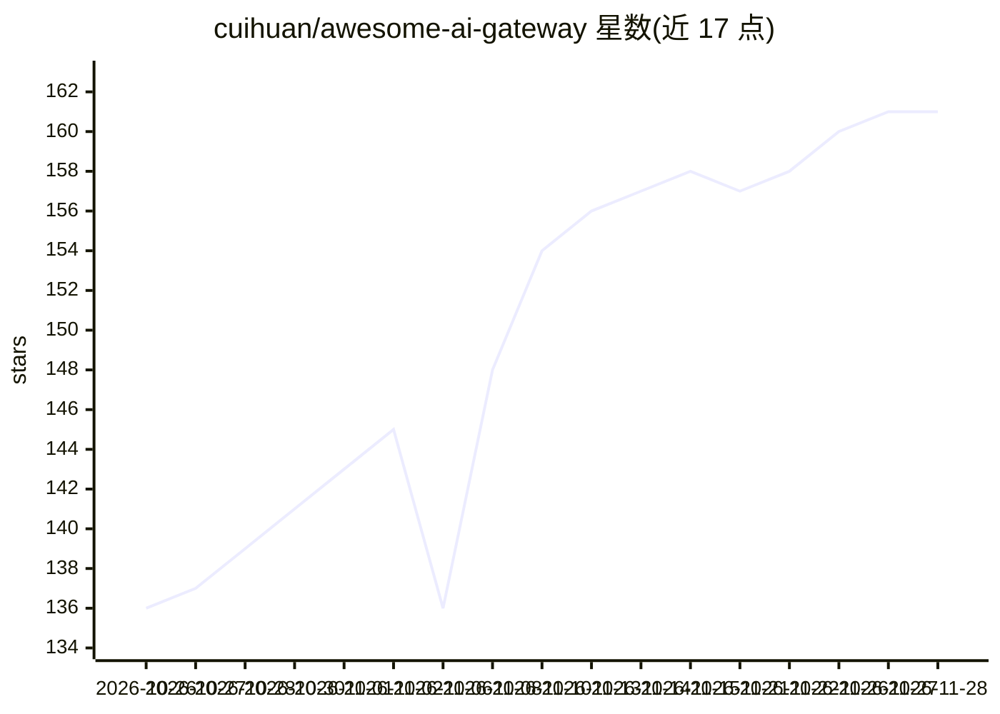

# cuihuan/awesome-ai-gateway

⭐ 161 · HTML · CC0-1.0 · 推送 2026-11-27 · [GitHub](https://github.com/cuihuan/awesome-ai-gateway) · [官网](https://cuihuan.github.io/awesome-ai-gateway/) · 个人维护 · 中文 README

**面向工程师的 AI 网关选型决策树与手册（覆盖 240+ 项目）**

一个关于 AI 网关的 awesome 清单与知识库：提供覆盖 240+ 网关项目的决策树（按路由、成本、可观测性、合规、缓存、K8s、MCP 等需求分支）、五轴评分与可复现的成本基准（用单元测试脚本从公开定价数据计算），并附 8 章手册讲解网关的工作原理与失败模式（兼容性、路由、可观测性、故障转移、缓存经济、计费、agent 网关）。英文/简体中文双语，CC0 许可，声明无厂商赞助与联盟链接，星标与发布数据通过 CI 每日刷新，快照审查存在积压。

## 筛选速览

| 维度 | 判定 | 备注 |
|---|---|---|
| AI 角色 | `ai-knowledge` | 知识聚合/清单类 |
| 许可风险 | `viral` | CC0-1.0 |
| 部署形态 | `library` | 以包/库形式分发 |
| 模型依赖 | — | README 未给出锁定关系 |
| 硬件要求 | — | 无带数字的原话,不猜 |
| 安装摩擦 | `low` | 无编译、无系统依赖或容器化 |
| 成熟度 | — | 结构信号不足 |

## 能力要点

- 覆盖 240+ 网关的决策树与五轴评分
- 可复现成本基准（脚本计算、CI 每日刷新星标数据）
- 8 章手册讲解网关机制与失败模式
- 披露 CVE、标注归档/停更项目、排除灰色中转

## 适用场景

- 为自托管或托管 AI 网关做选型决策
- 评估通过网关路由 Claude Code/Codex/Cursor 的兼容性
- 了解 2026 年独立网关赛道的并购与归档动态
- 核算不同模型下同一任务的 token 成本差异

## 场景标签

`模型网关` `精选清单` `教程课程` · 领域:Agent 开发

## 证据(README 行号)

> L8: > **Pick one in ~10 seconds, understand why, and check every number yourself.** A decision tree over 240+ gateways, 
> L22:  How this list works, in four steps: pick by requirement (routing, cost, observability, compliance, supply-chain, c
> L61: > **Why this matters:** the same task can cost **100× more** depending on the model behind your gateway. An **AI ga

## 星数曲线

2026-10-26 136 → 2026-11-28 161（+25）

---
*卡片 v1 · prompt 1.4 · 生成 2026-11-27 · 置信度 mid · 依据 README sha `b4597504139e` · [字段定义](../../DATASET.md)*
