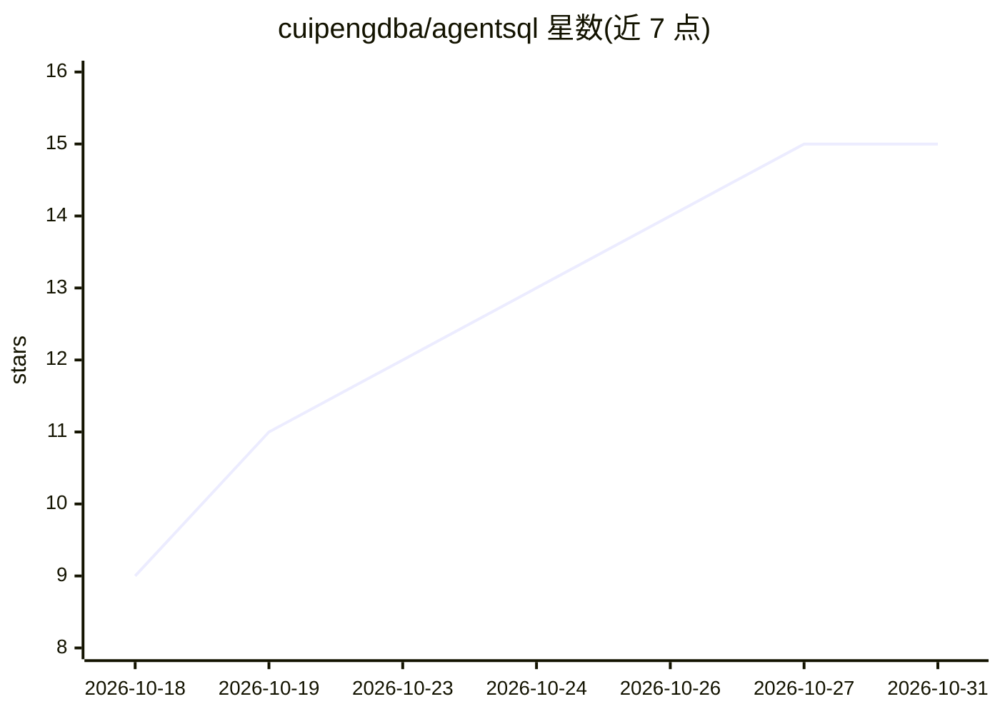

# cuipengdba/agentsql

⭐ 15 · Go · Apache-2.0 · 推送 2026-10-30 · [GitHub](https://github.com/cuipengdba/agentsql) · [官网](https://agentsql.cn) · 个人维护 · 中文 README

**面向 AI Agent 的数据库安全网关与生产级 MCP Server**

用 Go 编写的 Apache-2.0 项目（中文品牌名：智盾）：让模型发出的 PostgreSQL/MySQL 等数据库请求在到达数据库前，依次经过 API Key 认证、SQL 解析、授权与规则评估、受控执行、结果脱敏和持久审计，默认拒绝、fail-closed。提供 stdio 与 Streamable HTTP 双 MCP 承载、12+8 个数据库工具、内嵌 Web 控制台、审批、租户策略治理与多种审计导出。另提供自有问数/图表/仪表板页面，可独立使用，也可作为已有 SQLBot 部署的安全网关。已收录于 MCP 官方 Registry；适配多款国产数据库的指定版本受控只读，多数为合成实例验证、未覆盖完整生产支持。

## 筛选速览

| 维度 | 判定 | 备注 |
|---|---|---|
| AI 角色 | `ai-ecosystem` | LLM/agent 周边工具 |
| 许可风险 | `permissive` | Apache-2.0 |
| 部署形态 | `desktop` | 安装包/桌面程序 |
| 模型依赖 | — | README 未给出锁定关系 |
| 硬件要求 | — | 无带数字的原话,不猜 |
| 安装摩擦 | `low` | 无编译、无系统依赖或容器化 |
| 成熟度 | — | 结构信号不足 |

## 能力要点

- AI Agent 请求经认证、SQL AST 规则、授权、脱敏与持久审计的默认拒绝链路
- 双 MCP 承载（stdio 与 /mcp）提供 12 个基础工具，另附 8 个 B5 会话/计划工具
- 30 款数据库分四层能力目录，含金仓/瀚高/达梦/崖山/openGauss/Oracle/SQL Server/MongoDB/Redis/ClickHouse/Milvus 等指定版本受控只读
- 自有问数、图表、仪表板与嵌入应用页面，可独立使用或充当 SQLBot 安全网关

## 适用场景

- 给 AI Agent 的数据库访问加一层授权、脱敏与审计的网关
- 通过 MCP 让 Dify/MCP Inspector 等客户端安全查询多种数据库
- 用自有问数与仪表板页面独立搭建数据问答应用
- 对 Agent 的 SQL 访问做审批与租户级策略治理

## 场景标签

`网络安全` `数据分析` · 领域:效率与自动化

## 证据(README 行号)

> L15: AgentSQL（中文品牌名：智盾，控制台显示为「AgentSQL 智盾控制台」）是面向 AI Agent 的数据库安全网关与生产级 MCP Server：让模型发出的每条 PostgreSQL/MySQL 请求在到达数据库前，经
> L67: - 双 MCP 承载：本机 `stdio` 与 Streamable HTTP `/mcp`，提供 12 个基础数据库工具；默认开启的 PostgreSQL B5 会话/计划事务另提供 8 个工具。

## 星数曲线

2026-10-18 9 → 2026-10-31 15（+6）

---
*卡片 v1 · prompt 1.4 · 生成 2026-10-30 · 置信度 high · 依据 README sha `05f5268aacde` · [字段定义](../../DATASET.md)*
