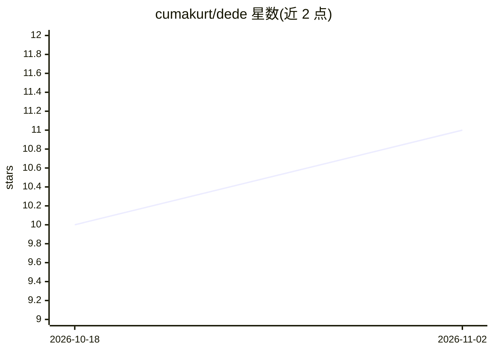

# cumakurt/dede

⭐ 11 · Python · AGPL-3.0 · 推送 2026-09-13 · [GitHub](https://github.com/cumakurt/dede) · 个人维护

**离线优先的多语言静态应用安全测试（SAST）工具，可选本地 Ollama 增强**

面向开发者的 SAST 工具：内置规则引擎（287 条规则、13 个规则包）、15 种语言的语义数据流分析（source-to-sink）、依赖可达性 SCA、密钥检测、安全加固检查，并可离线调用 Semgrep、Bandit、Gitleaks 等外部分析器。输出 JSON/HTML/PDF-A-3u/SARIF 2.1.0 报告，支持原生运行或只读加固的 Docker 隔离运行时，以及四种精度档位。AI 为可选功能：本地 Ollama 模型（默认 qwen3-coder:30b，约需 20GB 磁盘）用于解释发现和有限的漏洞搜索，--no-ai 可完全关闭。要求 Linux 与 Python 3.12+，AGPL-3.0-only 许可。

## 筛选速览

| 维度 | 判定 | 备注 |
|---|---|---|
| AI 角色 | `ai-enhanced` | 去掉 AI 部分产品仍成立 |
| 许可风险 | `viral` | AGPL-3.0 |
| 部署形态 | `self-host` | docker 或自建部署 |
| 模型依赖 | local-ok | 支持本地模型 |
| 硬件要求 | — | 无带数字的原话,不猜 |
| 安装摩擦 | `low` | 无编译、无系统依赖或容器化 |
| 成熟度 | — | 结构信号不足 |

## 能力要点

- 15 种语言的语义数据流分析与 287 条内置规则
- JSON/HTML/PDF-A-3u/SARIF 2.1.0 四种报告格式与攻击图、策略门禁
- 原生运行或只读加固 Docker 隔离运行时（丢弃 Linux capabilities）
- 可选本地 Ollama AI 增强：解释发现与有限咨询式漏洞搜索

## 适用场景

- 在离线环境中扫描源码树查找安全漏洞而不上传代码
- CI 中以 SARIF 报告和失败阈值做安全门禁
- 用本地模型解释扫描发现并做辅助漏洞排查

## 场景标签

`网络安全` · 领域:学习与行业

## 证据(README 行号)

> L6:  optional Docker isolation, and optional local Ollama enrichment.
> L12: installed. A local Ollama model can explain findings and perform a bounded,
> L91: - Ollama for AI enrichment;

## 星数曲线

2026-10-18 10 → 2026-11-02 11（+1）

---
*卡片 v1 · prompt 1.4 · 生成 2026-11-02 · 置信度 high · 依据 README sha `b6050f7fd99c` · [字段定义](../../DATASET.md)*
