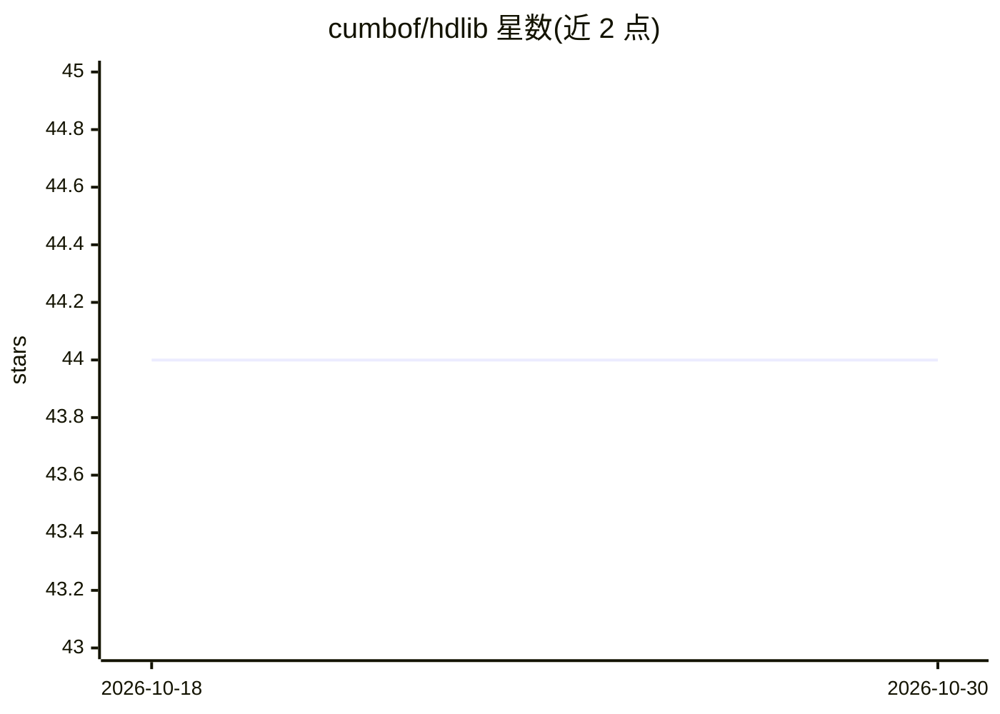

# cumbof/hdlib

⭐ 44 · Python · MIT · 推送 2026-10-22 · [GitHub](https://github.com/cumbof/hdlib) · [官网](https://cumbof.github.io/hdlib/) · 个人维护

**构建向量符号架构（VSA/超维计算）的 Python 3 库**

hdlib 是用于设计 Vector-Symbolic Architectures（VSA，又称超维计算）的 Python 3 库，通过在高维空间中组合向量来表示与处理信息。库内提供超维向量与空间、算术运算、距离计算等模块，并附带分类、聚类、回归、图编码、步进特征选择等机器学习示例，应用覆盖生物信息学、医学信息学、化学信息学等场景。以 MIT 许可通过 PyPI 与 conda-forge 渠道分发，GitHub releases 同步归档于 Zenodo。另有 hdlib-skills 仓库提供教 LLM agent 使用本库的 Agent Skills。

## 筛选速览

| 维度 | 判定 | 备注 |
|---|---|---|
| AI 角色 | `ai-native` | 本体是模型或模型工具 |
| 许可风险 | `permissive` | MIT |
| 部署形态 | `library` | 以包/库形式分发 |
| 模型依赖 | — | README 未给出锁定关系 |
| 硬件要求 | — | 无带数字的原话,不猜 |
| 安装摩擦 | `low` | 无编译、无系统依赖或容器化 |
| 成熟度 | — | 结构信号不足 |

## 能力要点

- 提供超维向量、空间与算术运算模块
- 内置分类/聚类/回归/图编码/特征选择示例
- 通过 PyPI 与 conda-forge 以 MIT 许可分发
- 配套 hdlib-skills 教 LLM agent 使用本库

## 适用场景

- 科研中构建与实验向量符号架构
- 生物医学数据的超维计算分类与特征选择
- 为 LLM 编程助手提供 hdlib 使用技能

## 场景标签

 · 领域:计算范式/机器学习库（生物医学等应用）

## 证据(README 行号)

> L3: Hyperdimensional Computing Library for building Vector-Symbolic Architectures in Python 3.
> L9: Vector-Symbolic Architectures (VSA, a.k.a. Hyperdimensional Computing) is an emergent computing paradigm that works 

## 星数曲线

2026-10-18 44 → 2026-10-30 44（+0）

---
*卡片 v1 · prompt 1.4 · 生成 2026-10-25 · 置信度 high · 依据 README sha `e56ff3c7e9e0` · [字段定义](../../DATASET.md)*
