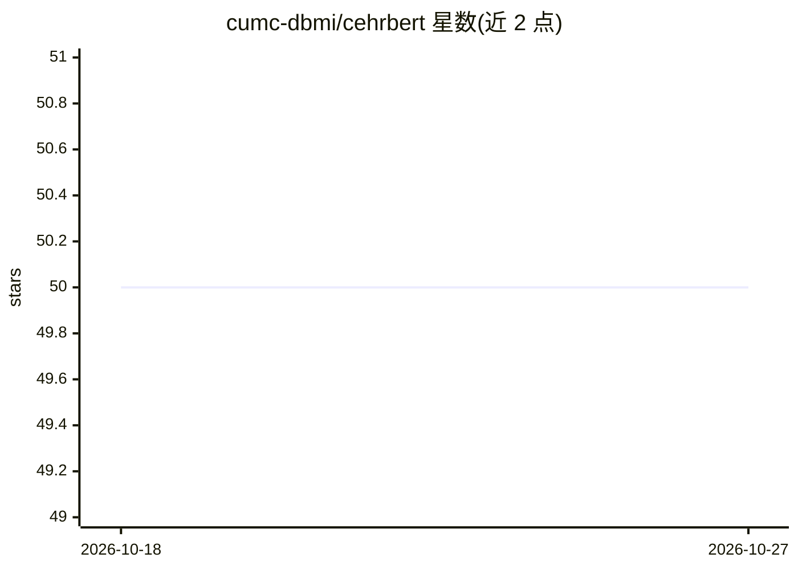

# cumc-dbmi/cehrbert

⭐ 50 · Python · MIT · 推送 2025-12-09 · [GitHub](https://github.com/cumc-dbmi/cehrbert) · 组织维护

**面向结构化 EHR 数据的时间感知 BERT 预训练与预测框架**

CEHR-BERT 是针对 OMOP/MEDS 格式结构化电子病历数据（EHR）开发的 BERT 类模型与端到端框架，含数据生成、模型预训练、微调与评估三部分。通过人工时间标记（ATT）与就诊起止标记（VS/VE）将患者事件序列按时序编码，采用 Masked Language Model 加就诊类型预测双目标预训练，用于心衰再入院等下游预测任务。OMOP 与 MEDS 两种格式训练的模型互不兼容。数据管道使用 PySpark，提供 1M 患者 Synthea 示例数据集。

## 筛选速览

| 维度 | 判定 | 备注 |
|---|---|---|
| AI 角色 | `ai-native` | 本体是模型或模型工具 |
| 许可风险 | `permissive` | MIT |
| 部署形态 | `library` | 以包/库形式分发 |
| 模型依赖 | — | README 未给出锁定关系 |
| 硬件要求 | — | 无带数字的原话,不猜 |
| 安装摩擦 | `low` | 无编译、无系统依赖或容器化 |
| 成熟度 | — | 结构信号不足 |

## 能力要点

- ATT/VS/VE 时间与就诊标记的患者序列表示
- MLM + 就诊类型预测双预训练目标
- 支持 OMOP 与 MEDS 两种数据格式（模型互不兼容）
- 含 HF 再入院预测等下游任务的数据生成与微调流程

## 适用场景

- 在 OMOP/MEDS 病历数据上预训练 EHR 领域 BERT
- 做心衰再入院等疾病预测任务的微调评估
- 扩展自定义预训练模型与预测任务（抽象类扩展）

## 场景标签

`模型训练` `微调` · 领域:训练与推理

## 证据(README 行号)

> L9: CEHR-BERT is a large language model developed for the structured EHR data, the work has been published
> L13: There are three major components in CEHR-BERT, data generation, model pre-training, and model evaluation with
> L64: ## OMOP vs. MEDS Format Considerations

## 星数曲线

2026-10-18 50 → 2026-10-27 50（+0）

---
*卡片 v1 · prompt 1.4 · 生成 2026-10-24 · 置信度 high · 依据 README sha `fa5e3395ab75` · [字段定义](../../DATASET.md)*
