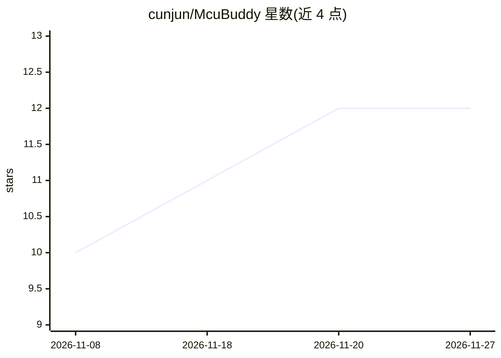

# cunjun/McuBuddy

⭐ 12 · Python · MIT · 推送 2026-08-17 · [GitHub](https://github.com/cunjun/McuBuddy) · 个人维护 · 中文 README

**面向嵌入式固件开发者的 MCP 服务器：让 AI 调试真实 MCU 硬件**

一个 Model Context Protocol（MCP）服务器，将调试探针、Keil MDK 工程、ELF/DWARF 符号、CPU/内存状态、SVD 外设寄存器、UART/RTT 日志、FreeRTOS 状态和 Flash 操作暴露为 AI 助手可调用的结构化工具，覆盖诊断、改码、构建、烧录、验证的完整闭环。默认 core 档提供 19 个稳定工具，可按域（probe/diagnose/build_flash/rtos/logs/experimental）显式启用。本地 stdio 进程运行，不提供网络监听；带机器可读的安全分级与确认机制。Keil 构建下载功能仅限 Windows + Keil MDK。

## 筛选速览

| 维度 | 判定 | 备注 |
|---|---|---|
| AI 角色 | `ai-ecosystem` | LLM/agent 周边工具 |
| 许可风险 | `permissive` | MIT |
| 部署形态 | `desktop` | 安装包/桌面程序 |
| 模型依赖 | locked-api |  |
| 硬件要求 | — | 无带数字的原话,不猜 |
| 安装摩擦 | `low` | 无编译、无系统依赖或容器化 |
| 成熟度 | — | 结构信号不足 |

## 能力要点

- 通过 MCP 将真实硬件调试能力暴露为 AI 可调用工具（默认 19 个）
- 支持 ST-Link、J-Link、CMSIS-DAP 探针与 pyOCD/J-Link GDB server
- 基于 ELF/DWARF 做源级故障定位，解码 CMSIS-SVD 外设寄存器与 FreeRTOS 状态
- 机器可读的安全分级：写操作与 Flash 操作需显式确认

## 适用场景

- 固件开发与板级 bring-up 时让 AI 读取寄存器、内存与断点状态
- HardFault、栈溢出等故障的源级定位与自动化排查
- 让 AI 完成改码→Keil 构建→烧录→真板验证的闭环流程
- 通过 GDB server 与 RTT/UART 日志做运行时可观测

## 场景标签

`编码 Agent` · 领域:编码与开发

## 证据(README 行号)

> L11: `McuBuddy` is a Model Context Protocol (MCP) server for
> L14: and GDB servers as structured tools that AI assistants can call.
> L56:     AI["AI Client Codex / Claude Code"] --> MCP["McuBuddy MCP Server"]
> L61: MCP is not a protocol for invoking Keil. The AI calls `McuBuddy` through MCP; `McuBuddy` then

## 星数曲线

2026-11-08 10 → 2026-11-27 12（+2）

---
*卡片 v1 · prompt 1.4 · 生成 2026-11-18 · 置信度 high · 依据 README sha `ecb947b4f1bd` · [字段定义](../../DATASET.md)*
