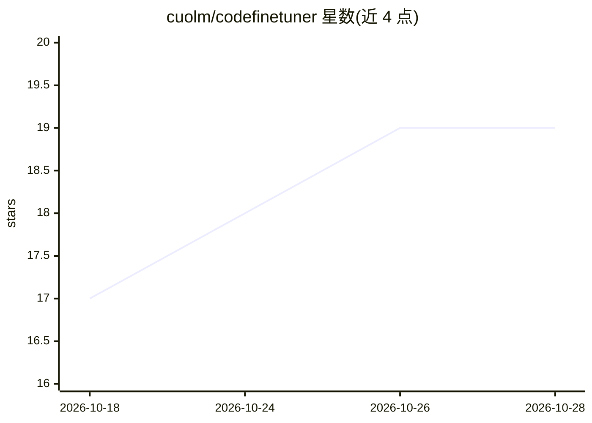

# cuolm/codefinetuner

⭐ 19 · Python · Apache-2.0 · 推送 2026-09-14 · [GitHub](https://github.com/cuolm/codefinetuner) · 个人维护

**本地代码补全模型微调工具：在自有仓库上训练 LoRA 并导出 GGUF**

面向希望获得专属补全模型的开发者：从代码仓库解析函数/类等结构块，生成 Structure-Aware Fill-in-the-Middle 训练样本，用 LoRA 微调基础模型（如 Qwen2.5-Coder），再转换为 GGUF 格式供 llama.vim / llama.vscode 等编辑器端本地推理使用。整个流程在本地运行，代码不离开本机。提供 CLI 与 Python 模块两种使用方式、单一 YAML 配置文件、多指标评估（CodeBLEU/BLEU/困惑度等）、可选 MLflow 跟踪与 GPU/CPU Docker 镜像。硬件层面 GPU 训练为可选，无 GPU 时回退 CPU 但速度慢。

## 筛选速览

| 维度 | 判定 | 备注 |
|---|---|---|
| AI 角色 | `ai-ecosystem` | LLM/agent 周边工具 |
| 许可风险 | `permissive` | Apache-2.0 |
| 部署形态 | `self-host` | docker 或自建部署 |
| 模型依赖 | local-ok | 支持本地模型 |
| 硬件要求 | — | 无带数字的原话,不猜 |
| 安装摩擦 | `low` | 无编译、无系统依赖或容器化 |
| 成熟度 | — | 结构信号不足 |

## 能力要点

- 基于 Tree-sitter 结构块生成 FIM 训练样本
- LoRA 微调并导出 GGUF 供编辑器本地补全使用
- CodeBLEU/SentenceBLEU/编辑相似度/困惑度等多指标评估
- GPU/CPU 双 Docker 镜像与 MLflow 可选跟踪

## 适用场景

- 在 VS Code 或 Neovim 中使用针对自己代码库微调的补全模型
- 源码不出本机的前提下训练专属代码补全模型
- 对比多次微调实验的评估指标

## 场景标签

`微调` · 领域:训练与推理

## 证据(README 行号)

> L8: CodeFinetuner fine-tunes a local code autocomplete model on your own repository for use in editors like VS Code or V
> L9: It trains a Low-Rank Adapter (LoRA) on Structure-Aware Fill-in-the-Middle (FIM) examples so the model learns the str
> L19: CodeFinetuner follows a simple pipeline. First, raw code is parsed and turned into FIM examples. These examples are

## 星数曲线

2026-10-18 17 → 2026-10-28 19（+2）

---
*卡片 v1 · prompt 1.4 · 生成 2026-10-28 · 置信度 high · 依据 README sha `b1902a6017c2` · [字段定义](../../DATASET.md)*
