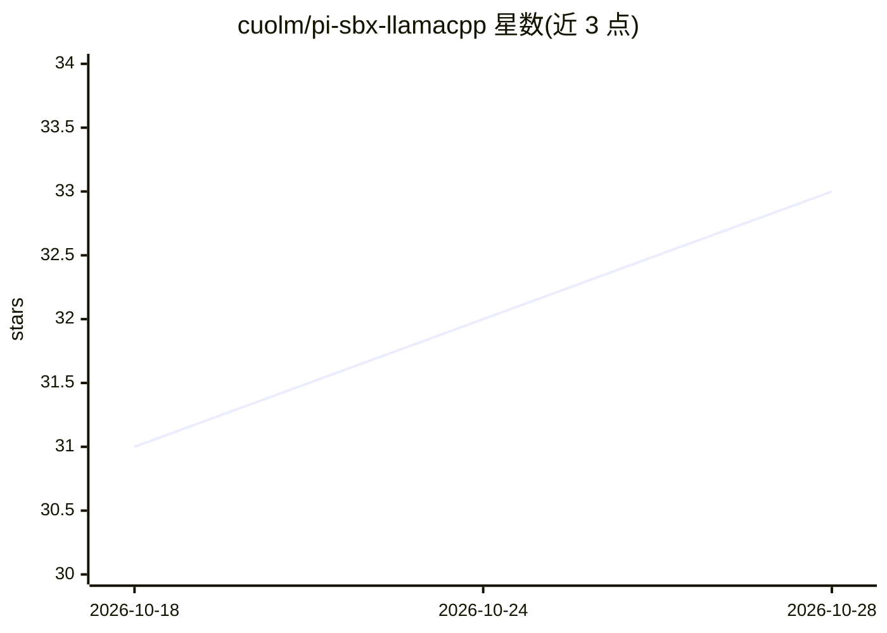

# cuolm/pi-sbx-llamacpp

⭐ 33 · MIT · 推送 2026-06-16 · [GitHub](https://github.com/cuolm/pi-sbx-llamacpp) · 个人维护

**在 Docker sbx 沙箱中运行 Pi 编程 agent 的配置指南**

一份分步指南与配套 kit 文件：将 Pi 编程 agent 部署在 Docker sbx microVM 内实现 hypervisor 级隔离（限制文件、密钥与网络访问），推理由宿主机上 router 模式的 llama-server 提供，通过 host.docker.internal 与 allowedDomains 代理跨 VM 通信。指南覆盖安装 sbx 与 llama.cpp、预下载 Gemma 12B/26B GGUF 模型、编写 spec.yaml/models.json/settings.json 并运行沙箱，模型在宿主 GPU 上按需动态加载。给想在隔离环境用本地模型驱动 Pi 的开发者使用。

## 筛选速览

| 维度 | 判定 | 备注 |
|---|---|---|
| AI 角色 | `ai-knowledge` | 知识聚合/清单类 |
| 许可风险 | `permissive` | MIT |
| 部署形态 | `library` | 以包/库形式分发 |
| 模型依赖 | local-ok | 支持本地模型 |
| 硬件要求 | — | 无带数字的原话,不猜 |
| 安装摩擦 | `high` | 编译与系统依赖俱全 |
| 成熟度 | — | 结构信号不足 |

## 能力要点

- sbx microVM 提供 hypervisor 级隔离，限制 Pi 对宿主文件/密钥/网络的访问
- llama-server router 模式统一端点，模型按需动态加载卸载
- 提供可复制的 kit 文件（spec.yaml/models.json/settings.json）
- 默认配置 Gemma 12B/26B QAT GGUF 量化模型

## 适用场景

- 在隔离沙箱中安全运行 AI 编程 agent 处理项目代码
- 用本地 llama-server GPU 推理替代云端模型驱动 Pi
- 参照 kit 结构自定义沙箱化的 agent 运行环境

## 场景标签

`编码 Agent` · 领域:编码与开发

## 证据(README 行号)

> L1: # Pi Coding Agent + Docker Sandbox + llama-server: Setup Guide
> L3: This guide runs the Pi coding agent inside an isolated Docker Sandbox (sbx) microVM, with inference served by a loca

## 星数曲线

2026-10-18 31 → 2026-10-28 33（+2）

---
*卡片 v1 · prompt 1.4 · 生成 2026-10-26 · 置信度 mid · 依据 README sha `68d8bff28b9a` · [字段定义](../../DATASET.md)*
