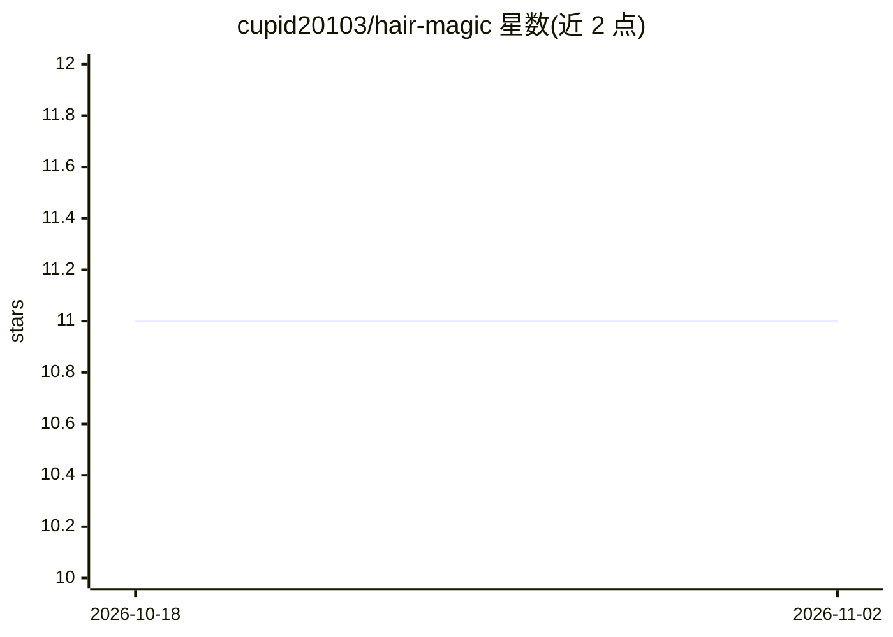

# cupid20103/hair-magic

⭐ 11 · TypeScript · 推送 2026-06-09 · [GitHub](https://github.com/cupid20103/hair-magic) · 个人维护

**上传自拍并描述发型，AI 生成换发效果的移动应用**

基于 Expo SDK 52 与 NativeWind 的跨平台移动应用（iOS/Android/Web），用户上传自拍或拍照、输入发型描述文本，应用将图片转为 base64 发送到 POST /api/hair 服务路由，由该路由调用 Replicate Predictions API 生成新发型图像，并以处理前后对比展示，支持继续精修与流行发型预设一键填充提示词。需要 Node.js v22+、Yarn、Expo Go 或开发构建，以及 Replicate 账号与 API token，通过 EAS Workflows 自动化构建部署。

## 筛选速览

| 维度 | 判定 | 备注 |
|---|---|---|
| AI 角色 | `ai-native` | 本体是模型或模型工具 |
| 许可风险 | `none` | — |
| 部署形态 | `None` |  |
| 模型依赖 | — | README 未给出锁定关系 |
| 硬件要求 | — | 无带数字的原话,不猜 |
| 安装摩擦 | `low` | 无编译、无系统依赖或容器化 |
| 成熟度 | — | 结构信号不足 |

## 能力要点

- 照片+文本提示词经 Replicate API 生成发型变换图像
- 处理前后对比展示与结果继续精修
- 流行发型预设一键填充提示词
- 支持相机拍摄或相册选图，含深色模式

## 适用场景

- 想换发型前预览不同发型效果
- 拍照后用文字描述生成新发型尝试
- 对比变换前后的发型效果

## 场景标签

`图像生成` · 领域:内容生成

## 证据(README 行号)

> L3: HairMagic is a cross-platform mobile app built with **Expo** and **NativeWind** that uses **Replicate AI** to genera
> L5: Upload a selfie, describe the hairstyle you want, and the app returns an AI-generated transformation with a before a
> L94: 3. The server route creates a Replicate prediction, polls until it succeeds or fails, and returns the generated ima

## 星数曲线

2026-10-18 11 → 2026-11-02 11（+0）

---
*卡片 v1 · prompt 1.4 · 生成 2026-11-02 · 置信度 high · 依据 README sha `a241de130b02` · [字段定义](../../DATASET.md)*
