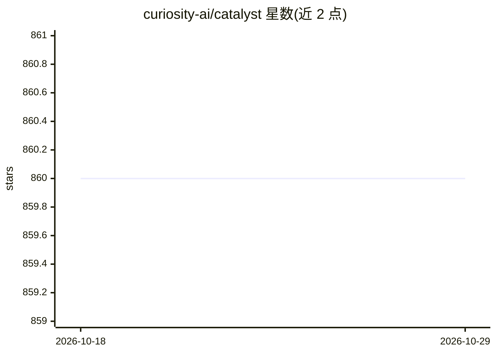

# curiosity-ai/catalyst

⭐ 860 · C# · MIT · 推送 2026-10-08 · [GitHub](https://github.com/curiosity-ai/catalyst) · 组织维护

**给 .NET 开发者的 C# 自然语言处理库**

纯 C# 实现的 NLP 库，面向 .NET 9/10 开发者，设计参考 spaCy。提供分词、词性标注、命名实体识别（词表/规则/感知机）、词形还原、语言检测、FastText/StarSpace 词与文档嵌入训练等能力；预训练模型基于 Universal Dependencies v2.7，以独立 NuGet 语言包分发，模型可从在线仓库惰性下载或经流式读写。跨平台运行于 Windows/Linux/macOS 及 ARM。

## 筛选速览

| 维度 | 判定 | 备注 |
|---|---|---|
| AI 角色 | `ai-native` | 本体是模型或模型工具 |
| 许可风险 | `permissive` | MIT |
| 部署形态 | `None` |  |
| 模型依赖 | — | README 未给出锁定关系 |
| 硬件要求 | — | 无带数字的原话,不猜 |
| 安装摩擦 | `medium` | 含编译或系统依赖之一 |
| 成熟度 | — | 结构信号不足 |

## 能力要点

- 非破坏性分词，>1M tokens/s，>99.9% 无 RegEx
- 命名实体识别（词表、规则、感知机三种方式）
- FastText/StarSpace 嵌入训练与 HNSW 嵌入搜索
- 基于 Universal Dependencies v2.7 的预训练模型按语言 NuGet 包分发

## 适用场景

- 在 C# 应用中做分词、词性标注与实体识别
- 训练并使用 FastText 词向量/文档嵌入
- 构建跨平台的 .NET 文本处理流水线

## 场景标签

`语义搜索` · 领域:知识与检索

## 证据(README 行号)

> L4: _**catalyst**_ is a C# Natural Language Processing library built for speed. Inspired by spaCy's design, it brings pr
> L12: - Named Entity Recognition (gazeteer, rule-based & perceptron-based)

## 星数曲线

2026-10-18 860 → 2026-10-29 860（+0）

---
*卡片 v1 · prompt 1.4 · 生成 2026-10-21 · 置信度 high · 依据 README sha `136572315f0f` · [字段定义](../../DATASET.md)*
