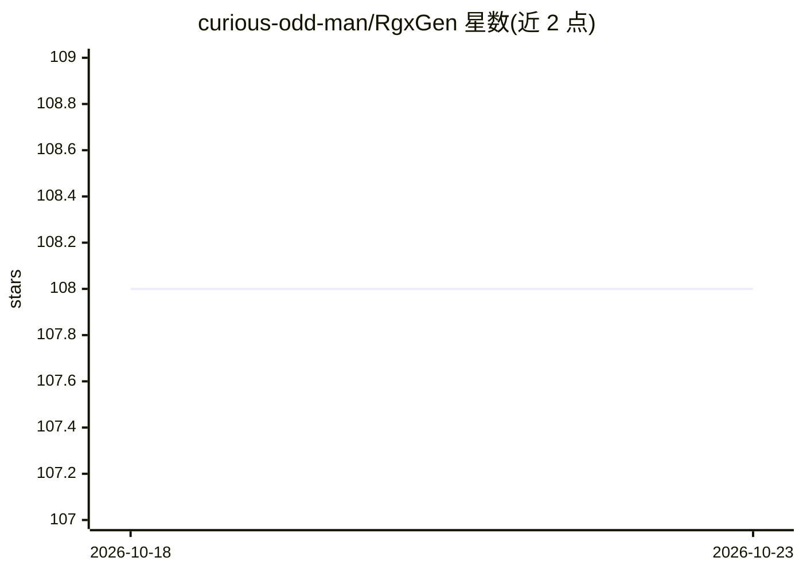

# curious-odd-man/RgxGen

⭐ 108 · Java · Apache-2.0 · 推送 2026-04-13 · [GitHub](https://github.com/curious-odd-man/RgxGen) · 个人维护

**Java 正则表达式字符串生成库：生成匹配与不匹配的字符串**

给定正则模式，该库可生成匹配字符串、迭代不重复的匹配字符串，以及生成不匹配字符串，用于测试数据构造等场景。支持常见正则语法（字符类、分组、命名组、十六进制/Unicode 字符、有限的前瞻后顾支持），可通过 RgxGenProperties 按实例配置（如点号匹配范围、无限模式的重复上限默认 100）。已知限制：非线程安全（#91）、$ 与 ^ 锚点被忽略（#120）、Unicode 类别结果依赖 Java 版本（#99）。以 Maven 依赖形式提供，无第三方依赖。

## 筛选速览

| 维度 | 判定 | 备注 |
|---|---|---|
| AI 角色 | `ai-enhanced` | 去掉 AI 部分产品仍成立 |
| 许可风险 | `permissive` | Apache-2.0 |
| 部署形态 | `None` |  |
| 模型依赖 | — | README 未给出锁定关系 |
| 硬件要求 | — | 无带数字的原话,不猜 |
| 安装摩擦 | `low` | 无编译、无系统依赖或容器化 |
| 成熟度 | — | 结构信号不足 |

## 能力要点

- 按正则模式生成匹配与不匹配字符串，并支持迭代唯一匹配值
- 无任何第三方依赖，通过 Maven Central 分发
- 实例级配置（点号匹配范围、重复上限、空白字符定义等）
- 对无限模式默认将随机生成的重复上限限制为 100

## 适用场景

- 按正则规则批量生成测试数据
- 生成与模式不匹配的字符串用于测试校验逻辑
- 迭代枚举一个正则的全部唯一匹配值

## 场景标签

 · 领域:软件开发工具/测试数据生成

## 证据(README 行号)

> L3: This is a java library that, given a regex pattern, allows to:
> L5: 1. Generate matching strings
> L7: 1. Generate not matching strings

## 星数曲线

2026-10-18 108 → 2026-10-23 108（+0）

---
*卡片 v1 · prompt 1.4 · 生成 2026-10-23 · 置信度 low · 依据 README sha `c4119fa1ecf0` · [字段定义](../../DATASET.md)*
