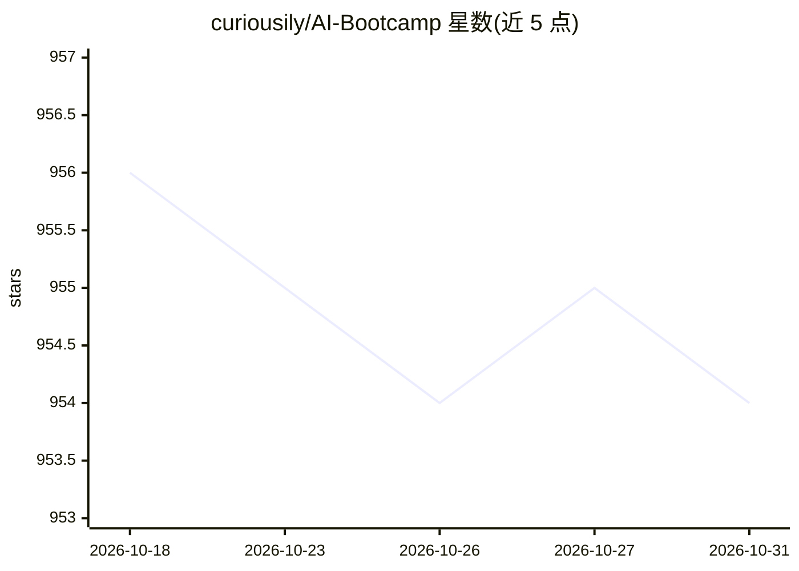

# curiousily/AI-Bootcamp

⭐ 954 · Jupyter Notebook · MIT · 推送 2026-10-11 · [GitHub](https://github.com/curiousily/AI-Bootcamp) · [官网](https://mlexpert.io) · 个人维护

**生成式 AI 自学训练营：从 ML 基础到 RAG 与 Agent 的教程合集**

名为 "Get Shit Done with AI" 的自学教程合集，以课程表格组织为 AI/ML 基础、MLOps 与生产系统、AI 系统工程、RAG 与上下文工程、Agent 与工作流五大模块。内容覆盖 Python/PyTorch 基础、数据管道与 AWS 部署、Ollama 本地运行、LangChain/LangGraph、微调（QLoRA）、DSPy、MCP 与多 Agent 系统，多数课程配有教程链接与视频，可在 Colab 中打开。面向希望成为 AI 工程师的学习者。

## 筛选速览

| 维度 | 判定 | 备注 |
|---|---|---|
| AI 角色 | `ai-knowledge` | 知识聚合/清单类 |
| 许可风险 | `permissive` | MIT |
| 部署形态 | `None` |  |
| 模型依赖 | — | README 未给出锁定关系 |
| 硬件要求 | — | 无带数字的原话,不猜 |
| 安装摩擦 | `low` | 无编译、无系统依赖或容器化 |
| 成熟度 | — | 结构信号不足 |

## 能力要点

- 五大模块课程结构，含教程链接与视频
- 覆盖 Ollama 本地运行、RAG、微调（QLoRA）、DSPy 提示优化
- 包含 MCP 协议与 LangGraph 多 Agent 实战课程
- 提供 Open In Colab 入口与 Discord/YouTube 社区

## 适用场景

- 按路径自学从 ML 基础到 LLM 应用工程的技能
- 学习用 Ollama 在本地运行模型并构建 RAG/Agent 系统
- 了解 MLOps 生产部署流程（Docker、AWS、MLflow）

## 场景标签

`教程课程` · 领域:学习与行业

## 证据(README 行号)

> L15: |Lesson|Description|Tutorial|Video|
> L38: |Lesson|Description|Tutorial|Video|
> L54: |Lesson|Description|Tutorial|Video|
> L68: |Lesson|Description|Tutorial|Video|

## 星数曲线

2026-10-18 956 → 2026-10-31 954（-2）

---
*卡片 v1 · prompt 1.4 · 生成 2026-10-21 · 置信度 high · 依据 README sha `7a9386582461` · [字段定义](../../DATASET.md)*
