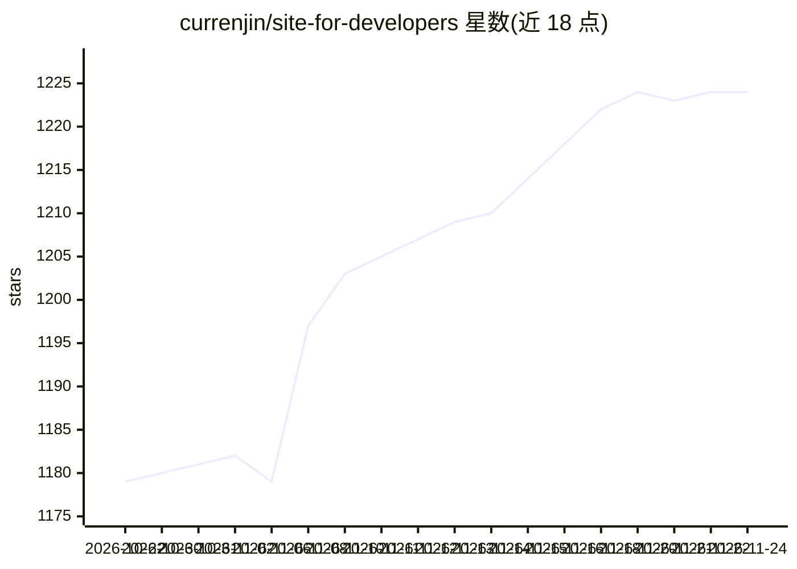

# currenjin/site-for-developers

⭐ 1,224 · Python · MIT · 推送 2026-11-21 · [GitHub](https://github.com/currenjin/site-for-developers) · [官网](https://currenjin.github.io/site-for-developers/) · 个人维护

**面向入门开发者的韩语开发资源书签清单（含 AI 工具分类）**

自称'所有开始开发的人的第一个书签'的策展清单：按推荐、AI 与开发工具、文档与参考、社区与学习、博客与视频、开发工具六大类组织链接。AI 部分细分为开发工具、设计工具、对话式 AI、API 与模型、Agent 与框架、本地 AI 工具、编码 Agent 管理工具七个子类。每条目带标签体系（开源/免费/付费/韩语/英语），推荐条目附确认日期、来源与未验证事项的记录，90 天未复查的记录标记为待复审。仓库 README 即清单本体，另提供网页构建部署指引。

## 筛选速览

| 维度 | 判定 | 备注 |
|---|---|---|
| AI 角色 | `ai-knowledge` | 知识聚合/清单类 |
| 许可风险 | `permissive` | MIT |
| 部署形态 | `None` |  |
| 模型依赖 | — | README 未给出锁定关系 |
| 硬件要求 | — | 无带数字的原话,不猜 |
| 安装摩擦 | `low` | 无编译、无系统依赖或容器化 |
| 成熟度 | — | 结构信号不足 |

## 能力要点

- 按六大类别组织的开发资源策展清单
- 开源/免费/付费/语言五类标签体系
- 推荐条目附确认日期与未验证事项记录，90 天后标记待复审
- AI 分类下含本地 AI 工具与编码 Agent 管理工具等子类

## 适用场景

- 开始学习开发时从一份清单找到语言文档、IDE、Git 与社区入口
- 查找 AI 编程助手与 LLM API 的候选并核对免费/付费标签
- 浏览本地运行 LLM 的开源工具选项

## 场景标签

`精选清单` · 领域:学习与行业

## 证据(README 行号)

> L27: > 개발을 시작하는 모든 사람의 **첫 번째 북마크**입니다.
> L29: > AI 도구부터 공식 문서, 커뮤니티까지 - 개발에 활용할 수 있는 리소스를 모았습니다.
> L70: - **AI 개발 도구** - Cursor, Claude Code, bolt.new 등

## 星数曲线

2026-10-22 1,179 → 2026-11-24 1,224（+45）

---
*卡片 v1 · prompt 1.4 · 生成 2026-11-23 · 置信度 high · 依据 README sha `46acf44e4b3f` · [字段定义](../../DATASET.md)*
