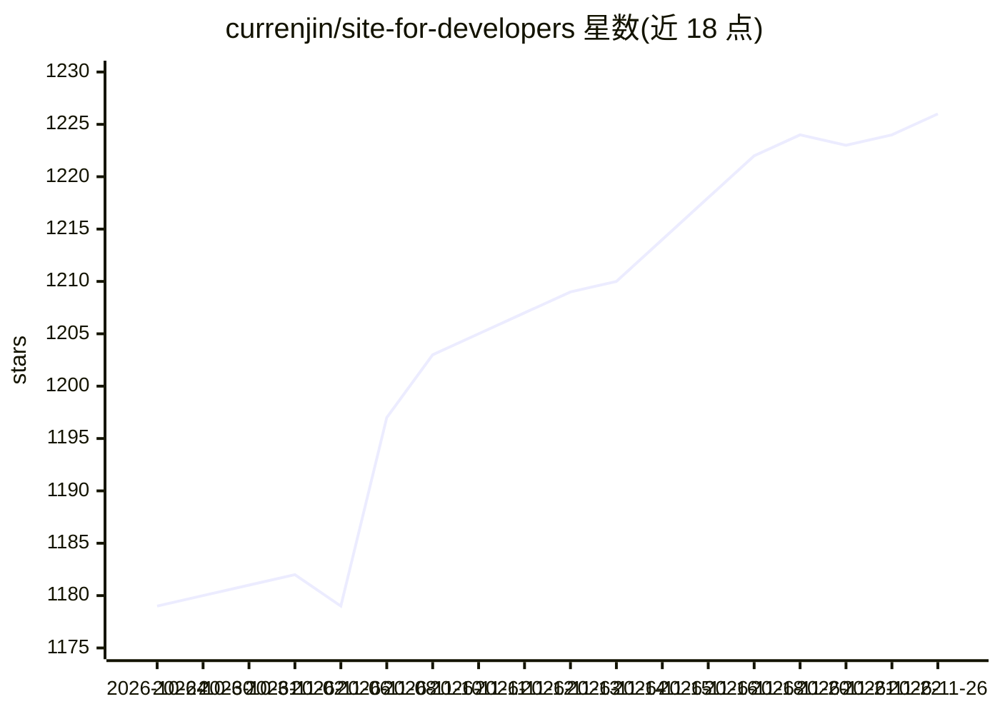

# currenjin/site-for-developers

⭐ 1,226 · Python · MIT · 推送 2026-11-25 · [GitHub](https://github.com/currenjin/site-for-developers) · [官网](https://currenjin.github.io/site-for-developers/) · 个人维护

**韩国开发者的开发资源书签目录，含 AI 工具分类**

以 README 形式维护的开发资源聚合清单，自称是开发者入门的第一个书签。条目按 AI 与开发工具、文档、社区与学习、博客、视频与开发工具等类别组织，每个条目带开源、免费、付费、韩语/英语标签，并附推荐理由与文档核对记录（含核对日期，超过 90 天标记待复审）。覆盖 AI 编码工具、对话式 AI、模型 API、agent 框架与本地 AI 工具等分类。清单本身不提供软件，修改通过编辑 README 完成。

## 筛选速览

| 维度 | 判定 | 备注 |
|---|---|---|
| AI 角色 | `ai-knowledge` | 知识聚合/清单类 |
| 许可风险 | `permissive` | MIT |
| 部署形态 | `None` |  |
| 模型依赖 | — | README 未给出锁定关系 |
| 硬件要求 | — | 无带数字的原话,不猜 |
| 安装摩擦 | `low` | 无编译、无系统依赖或容器化 |
| 成熟度 | — | 结构信号不足 |

## 能力要点

- 条目带 O/F/$/KR/EN 标签体系区分开源、免费、付费与语言
- 推荐条目附核对记录（核对日期、来源、未验证事项）并跟踪 90 天时效
- AI 类目覆盖编码工具、对话 AI、模型 API、agent 框架与本地 AI 工具

## 适用场景

- 入门开发者按路径查找语言文档、IDE、Git 学习与社区资源
- 挑选 AI 编码工具或对话式 AI 时浏览带核对说明的候选清单
- 比较本地模型运行工具与 LLM API 平台的可选项

## 场景标签

`精选清单` · 领域:学习与行业

## 证据(README 行号)

> L27: > 개발을 시작하는 모든 사람의 **첫 번째 북마크**입니다.
> L70: - **AI 개발 도구** - Cursor, Claude Code, bolt.new 등
> L74: - **에이전트 & 프레임워크** - LangChain, CrewAI, n8n 등

## 星数曲线

2026-10-24 1,179 → 2026-11-26 1,226（+47）

---
*卡片 v1 · prompt 1.4 · 生成 2026-11-26 · 置信度 high · 依据 README sha `39c0ac9bb073` · [字段定义](../../DATASET.md)*
