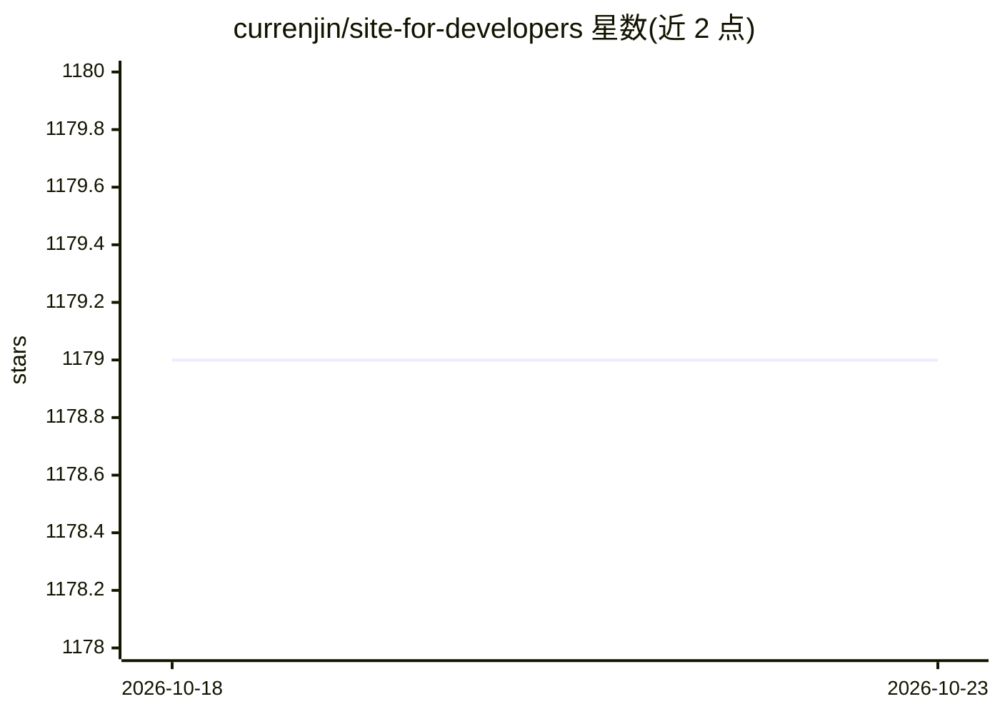

# currenjin/site-for-developers

⭐ 1,179 · MIT · 推送 2026-10-21 · [GitHub](https://github.com/currenjin/site-for-developers) · 个人维护 · 中文 README

**面向开发者的资源书签清单：AI 工具、文档、社区聚合**

韩国开发者维护的策展书签清单，定位为'开发者的第一个书签'。收录范围覆盖 AI 开发工具、对话式 AI、API 与模型平台、agent 框架、本地 AI 工具（Ollama/LM Studio/Jan 等）、各语言官方文档、云平台文档、社区、博客与视频资料。条目使用开源/免费/付费/韩语/英语标签体系，并对第三方 AI 网关的使用给出注意事项。非软件产品，无安装运行方式。

## 筛选速览

| 维度 | 判定 | 备注 |
|---|---|---|
| AI 角色 | `ai-knowledge` | 知识聚合/清单类 |
| 许可风险 | `permissive` | MIT |
| 部署形态 | `None` |  |
| 模型依赖 | — | README 未给出锁定关系 |
| 硬件要求 | — | 无带数字的原话,不猜 |
| 安装摩擦 | `low` | 无编译、无系统依赖或容器化 |
| 成熟度 | — | 结构信号不足 |

## 能力要点

- 覆盖 AI 工具、文档、社区、博客等 7 大类开发资源
- 开源(OSI)/免费/付费/韩语/英语的标签标注体系
- 包含本地 AI 工具、agent 框架与 API 平台条目
- 标注韩语(KR)可用性，收录韩国本土社区与文档

## 适用场景

- 初学开发者按类别查找入门文档与工具
- 比较对话式 AI、AI 编码工具等服务的免费/付费情况
- 查找韩国开发者社区与韩语技术资源

## 场景标签

`精选清单` · 领域:学习与行业

## 证据(README 行号)

> L25: > 개발을 시작하는 모든 사람의 **첫 번째 북마크**입니다.
> L64:  🤖 AI & 개발 도구 - AI를 활용한 개발 리소스

## 星数曲线

2026-10-18 1,179 → 2026-10-23 1,179（+0）

---
*卡片 v1 · prompt 1.4 · 生成 2026-10-21 · 置信度 high · 依据 README sha `c725300dfc1b` · [字段定义](../../DATASET.md)*
