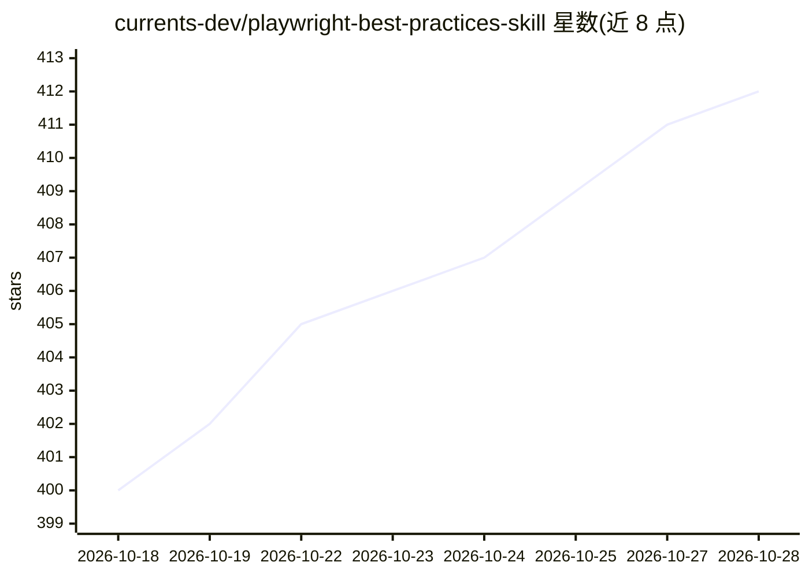

# currents-dev/playwright-best-practices-skill

⭐ 412 · MIT · 推送 2026-07-21 · [GitHub](https://github.com/currents-dev/playwright-best-practices-skill) · 组织维护

**Playwright 测试最佳实践 AI 技能包：给 AI 助手提供专项参考**

由 Currents.dev 维护的 AI Skill：包含 57 篇参考文档，按核心、调试、测试模式、进阶、浏览器 API、架构、框架、CI/CD 基础设施 8 类组织，覆盖 E2E、组件、API、视觉回归、无障碍、安全、i18n、Electron 与浏览器扩展测试等主题。SKILL.md 按用户当前活动映射到对应参考，按需加载内容。安装方式为 npx skills add 从 GitHub 添加，供在 TypeScript + Playwright 项目中使用 AI 编程助手的开发者采用。

## 筛选速览

| 维度 | 判定 | 备注 |
|---|---|---|
| AI 角色 | `ai-knowledge` | 知识聚合/清单类 |
| 许可风险 | `permissive` | MIT |
| 部署形态 | `library` | 以包/库形式分发 |
| 模型依赖 | — | README 未给出锁定关系 |
| 硬件要求 | — | 无带数字的原话,不猜 |
| 安装摩擦 | `low` | 无编译、无系统依赖或容器化 |
| 成熟度 | — | 结构信号不足 |

## 能力要点

- 57 篇参考文档按 8 个类别组织
- 基于活动的触发机制：按当前任务映射到对应参考，非一次性全量加载
- 覆盖 E2E/组件/API/视觉回归/无障碍/安全/i18n/Electron/扩展等测试主题
- 通过 npx skills add 一条命令安装

## 适用场景

- 让 AI 编程助手在写 Playwright 测试时遵循最佳实践
- 排查和修复 flaky 测试或调试失败
- 配置 Playwright 的 CI/CD、并行与分片运行

## 场景标签

 · 领域:软件测试/AI 编程辅助

## 证据(README 行号)

> L11: A skill that gives the AI specialized guidance for writing, debugging, and maintaining **Playwright** tests in **Ty
> L44: **57 reference documents** organized into 8 categories:
> L143: The skill's `SKILL.md` maps your current activity to these references so the right content is used in context.

## 星数曲线

2026-10-18 400 → 2026-10-28 412（+12）

---
*卡片 v1 · prompt 1.4 · 生成 2026-10-21 · 置信度 high · 依据 README sha `3a10afef6a12` · [字段定义](../../DATASET.md)*
