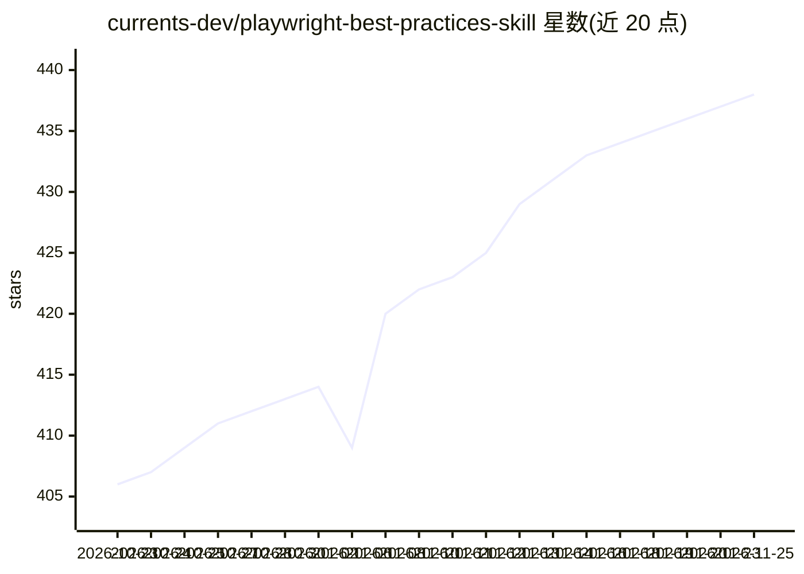

# currents-dev/playwright-best-practices-skill

⭐ 438 · MIT · 推送 2026-11-08 · [GitHub](https://github.com/currents-dev/playwright-best-practices-skill) · 组织维护

**为 AI 助手提供 Playwright 最佳实践的技能包**

由 currents.dev 发布的 AI Skill（技能包），为使用 Playwright 编写 TypeScript 测试的 AI 助手提供专门指导。内含 57 篇参考文档，按核心、调试、测试模式、高级、浏览器 API、架构、框架、CI/CD 基础设施 8 个类别组织，覆盖 E2E、组件、API、视觉回归、无障碍、安全、i18n、Electron 与浏览器扩展测试。技能按活动触发：SKILL.md 将用户当前任务映射到对应参考文档，按需加载内容。通过 npx skills add 命令安装，MIT 许可。

## 筛选速览

| 维度 | 判定 | 备注 |
|---|---|---|
| AI 角色 | `ai-knowledge` | 知识聚合/清单类 |
| 许可风险 | `permissive` | MIT |
| 部署形态 | `library` | 以包/库形式分发 |
| 模型依赖 | — | README 未给出锁定关系 |
| 硬件要求 | — | 无带数字的原话,不猜 |
| 安装摩擦 | `low` | 无编译、无系统依赖或容器化 |
| 成熟度 | — | 结构信号不足 |

## 能力要点

- 57 篇参考文档，按 8 个类别组织
- 活动驱动机制：SKILL.md 按当前任务映射到对应参考文档
- 覆盖 E2E、组件、API、视觉回归、无障碍、安全、i18n、Electron、浏览器扩展测试
- 含 GitHub Actions、GitLab CI、Docker 等基础设施文档

## 适用场景

- 让 AI 助手按最佳实践编写或重构 Playwright 测试
- 诊断和修复 flaky 测试与失败用例
- 搭建 Playwright 的 CI/CD 流水线与并行分片配置

## 场景标签

`代码生成` · 领域:编码与开发

## 证据(README 行号)

> L11: A skill that gives the AI specialized guidance for writing, debugging, and maintaining **Playwright** tests in **Ty
> L44: **57 reference documents** organized into 8 categories:
> L143: The skill's `SKILL.md` maps your current activity to these references so the right content is used in context.

## 星数曲线

2026-10-23 406 → 2026-11-25 438（+32）

---
*卡片 v1 · prompt 1.4 · 生成 2026-11-25 · 置信度 high · 依据 README sha `11bfd7383d69` · [字段定义](../../DATASET.md)*
