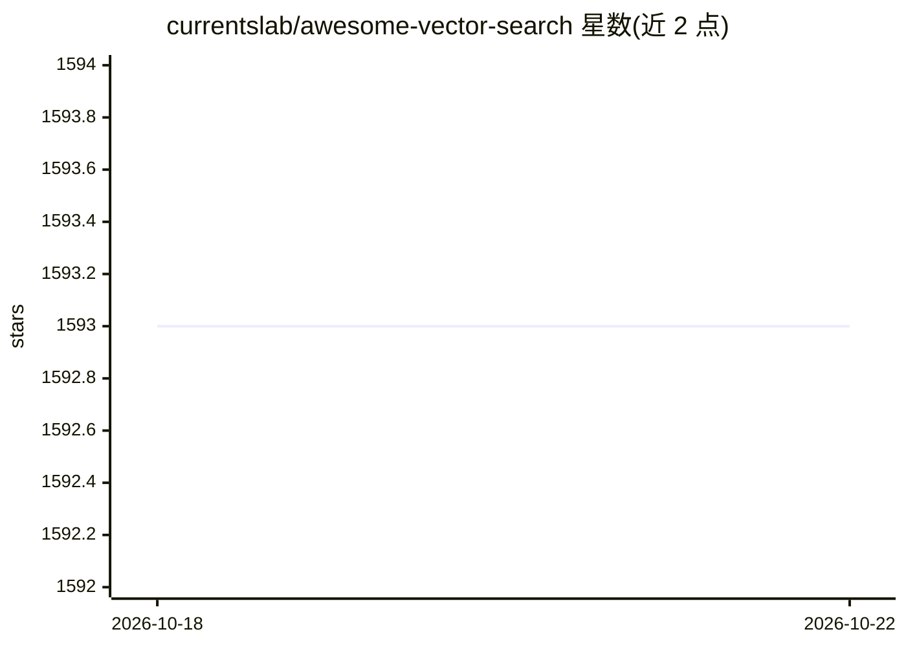

# currentslab/awesome-vector-search

⭐ 1,593 · MIT · 推送 2026-07-06 · [GitHub](https://github.com/currentslab/awesome-vector-search) · 个人维护

**向量检索引擎/库/云服务与研究论文的策展清单**

一个 awesome 类型的策展清单，收录向量相似性检索相关的独立服务（Qdrant、Milvus、Weaviate、pgvector 等）、库（Faiss、Annoy、NMSLIB、USense 类 ANN 库等）、云服务（Pinecone、Zilliz Cloud 等）以及 7 篇近似最近邻检索研究论文，按四大类别组织条目，仅含名称与一句话描述，不含代码或安装说明。面向选型与调研向量检索方案的开发者与科研人员。

## 筛选速览

| 维度 | 判定 | 备注 |
|---|---|---|
| AI 角色 | `ai-knowledge` | 知识聚合/清单类 |
| 许可风险 | `permissive` | MIT |
| 部署形态 | `library` | 以包/库形式分发 |
| 模型依赖 | — | README 未给出锁定关系 |
| 硬件要求 | — | 无带数字的原话,不猜 |
| 安装摩擦 | `medium` | 含编译或系统依赖之一 |
| 成熟度 | — | 结构信号不足 |

## 能力要点

- 覆盖独立服务/库/云服务/研究论文四类条目
- 收录 Faiss、ScaNN、HNSW 等主流 ANN 方法对应实现与论文
- 包含 pgvector、Chroma、USearch 等嵌入向量存储方案

## 适用场景

- 对比选型向量数据库或检索引擎
- 查找近似最近邻检索的实现库
- 追踪向量检索方向的研究论文

## 场景标签

`精选清单` · 领域:学习与行业

## 证据(README 行号)

> L3: > A curated list of awesome vector search framework/engine, library, cloud service and research papers to vector sim
> L5: ### Standalone Service

## 星数曲线

2026-10-18 1,593 → 2026-10-22 1,593（+0）

---
*卡片 v1 · prompt 1.4 · 生成 2026-10-21 · 置信度 mid · 依据 README sha `bbd32945455e` · [字段定义](../../DATASET.md)*
