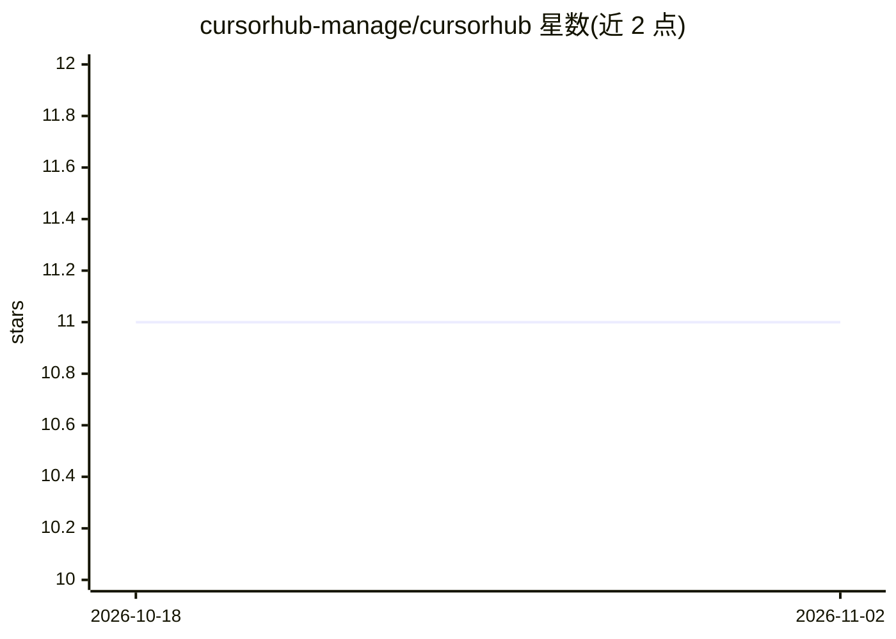

# cursorhub-manage/cursorhub

⭐ 11 · 推送 2025-12-08 · [GitHub](https://github.com/cursorhub-manage/cursorhub) · 组织维护 · 中文 README

**Cursor AI 编辑器的多账号切换与机器 ID 重置工具**

面向 Cursor AI 编辑器用户的桌面账号管理器：导入 WorkosSessionToken、JWT Token 或混合多行格式的账号，自动识别去重；应用账号时检测并关闭 Cursor、重置机器 ID、写入新 Token 后提示重启。提供 macOS（.dmg，10.15+）、Windows（.exe，10/11）与 Linux（.AppImage）安装包，从 GitHub Releases 下载即可使用。

## 筛选速览

| 维度 | 判定 | 备注 |
|---|---|---|
| AI 角色 | `ai-ecosystem` | LLM/agent 周边工具 |
| 许可风险 | `none` | — |
| 部署形态 | `desktop` | 安装包/桌面程序 |
| 模型依赖 | — | README 未给出锁定关系 |
| 硬件要求 | — | 无带数字的原话,不猜 |
| 安装摩擦 | `low` | 无编译、无系统依赖或容器化 |
| 成熟度 | — | 结构信号不足 |

## 能力要点

- 支持 WorkosSessionToken / JWT Token /混合多行导入并自动去重
- 一键切换账号：检测并关闭 Cursor、重置机器 ID、写入新 Token
- 提供 macOS / Windows / Linux 三平台安装包

## 适用场景

- 在多个 Cursor 账号之间快速切换
- 批量粘贴 Token 导入并管理账号
- 切换账号时自动重置机器 ID

## 场景标签

 · 领域:开发工具/账号管理

## 证据(README 行号)

> L3: > 一款强大的 Cursor AI 编辑器账号管理工具
> L56: 2. 粘贴 Cursor 的 Cookie 或 Token
> L83:  - 检测 Cursor 是否运行

## 星数曲线

2026-10-18 11 → 2026-11-02 11（+0）

---
*卡片 v1 · prompt 1.4 · 生成 2026-11-02 · 置信度 high · 依据 README sha `1a34f7e1a89a` · [字段定义](../../DATASET.md)*
