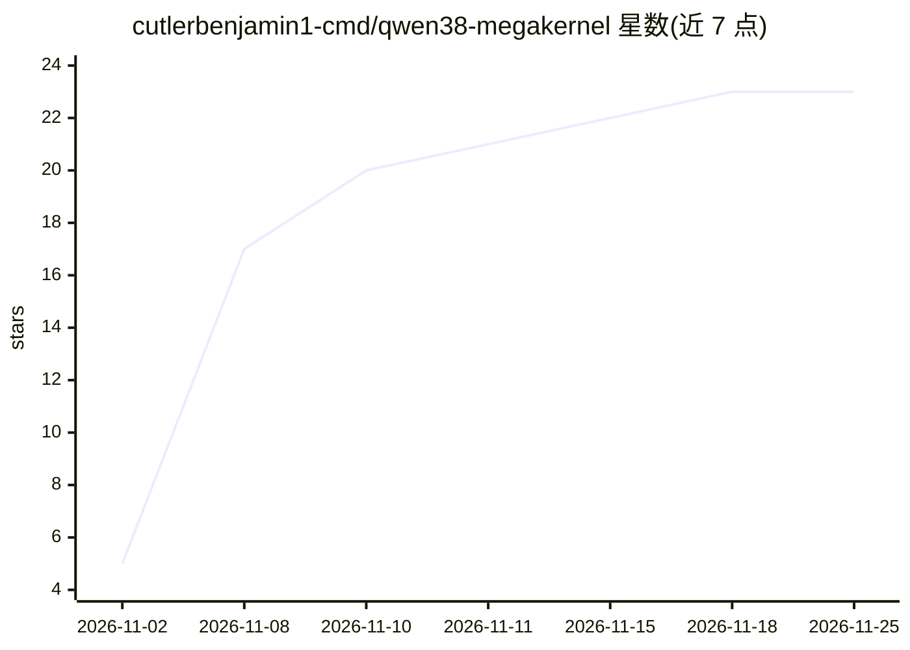

# cutlerbenjamin1-cmd/qwen38-megakernel

⭐ 23 · Cuda · AGPL-3.0 · 推送 2026-11-11 · [GitHub](https://github.com/cutlerbenjamin1-cmd/qwen38-megakernel) · 个人维护

**单卡 24GB GPU 运行 Qwen3.8-27B 的 CUDA 推理引擎与服务器**

面向单一模型（Qwen3.8-27B）的 CUDA 推理引擎与服务器：在一张 RTX 3090（24 GB）上运行完整 262k 上下文，通过 5-6 位低比特 KV 预设（最新 2,048 位置保持 8 位）压缩显存占用；提供模型自带 MTP 头的投机采样（每步最多 7 个草稿，GPU 上验证）、可跨追问/编辑/恢复会话的精确对话缓存，并保证贪婪输出在不同草稿数与缓存状态下逐位一致。对外实现 OpenAI、Anthropic Messages 与 OpenAI Responses API，可对接编码 agent 与聊天界面；提供 Windows/Linux 预构建包与源码构建路径。限制：构建依赖 llama.cpp 的分词器与图像库，40 系显卡未测试，部分特性（深度草稿、int8 attention）需选配源码构建。

## 筛选速览

| 维度 | 判定 | 备注 |
|---|---|---|
| AI 角色 | `ai-ecosystem` | LLM/agent 周边工具 |
| 许可风险 | `viral` | AGPL-3.0 |
| 部署形态 | `desktop` | 安装包/桌面程序 |
| 模型依赖 | local-ok | 支持本地模型 |
| 硬件要求 | — | 无带数字的原话,不猜 |
| 安装摩擦 | `high` | 编译与系统依赖俱全 |
| 成熟度 | `idea` | |

## 能力要点

- 24 GB 单卡运行完整 262k 上下文（低比特 KV 预设 D/F）
- 自带 MTP 头的投机采样，贪婪输出在不同草稿数下逐位一致
- 对话缓存支持追问、编辑、恢复会话且结果与全新请求逐位相同
- 实现 OpenAI / Anthropic Messages / OpenAI Responses API，经 11 个编码 agent 与聊天 UI 测试

## 适用场景

- 在一张 24 GB 消费级显卡上本地运行 Qwen3.8-27B 并保留完整长上下文
- 为 Claude Code、Codex CLI 等编码 agent 提供本地兼容 API 服务
- 需要可复现、确定输出的长上下文推理场景

## 场景标签

`推理引擎` · 领域:训练与推理

## 证据(README 行号)

> L5: A CUDA engine and server built for one model. On an RTX 3090 it decodes 166 tok/s on short prompts and 116 tok/s wit
> L8: weight. It speaks the OpenAI, Anthropic and OpenAI Responses APIs, so coding agents and chat UIs connect to it
> L200: The server implements OpenAI chat completions (`/v1/chat/completions`), the Anthropic Messages API (`/v1/messages`

## 星数曲线

2026-11-02 5 → 2026-11-25 23（+18）

---
*卡片 v1 · prompt 1.4 · 生成 2026-11-18 · 置信度 mid · 依据 README sha `63210401e039` · [字段定义](../../DATASET.md)*
