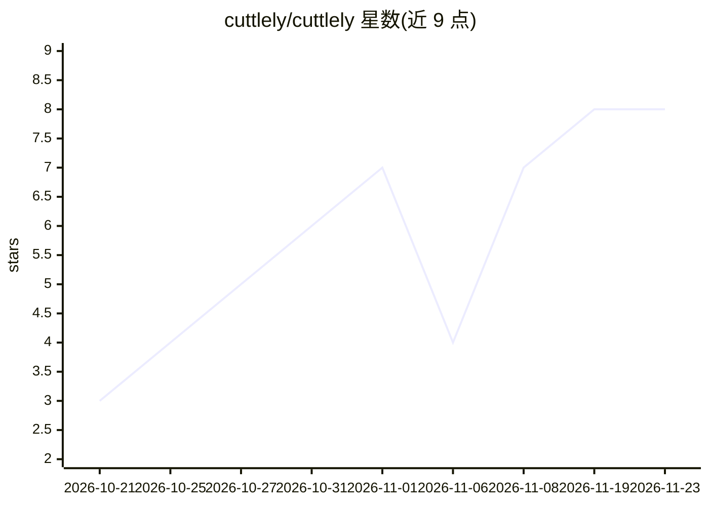

# cuttlely/cuttlely

⭐ 8 · JavaScript · Apache-2.0 · 推送 2026-11-22 · [GitHub](https://github.com/cuttlely/cuttlely) · [官网](https://cuttlely.com) · 组织维护

**自托管可视化编排 AI agent 团队的平台**

Cuttlely 以可视化方式构建 AI agent 团队（harness）：lead agent（Harness Prime）拆分问题并分发给各 specialist，每个 specialist 可配置自己的模型、工具、playbook 与数据。发布前用真实问题在 Live 与草稿上并排回放对比，支持通过测试集门禁才允许 Publish、版本历史与回滚、Dev/Prod 双服务器同步到同一 GitHub 仓库。提供角色权限、团队、登录与审计日志等团队功能，通过 API/embed 将 agent 团队接入应用。需 Node 20+ 与 Docker。

## 筛选速览

| 维度 | 判定 | 备注 |
|---|---|---|
| AI 角色 | `ai-ecosystem` | LLM/agent 周边工具 |
| 许可风险 | `permissive` | Apache-2.0 |
| 部署形态 | `self-host` | docker 或自建部署 |
| 模型依赖 | — | README 未给出锁定关系 |
| 硬件要求 | — | 无带数字的原话,不猜 |
| 安装摩擦 | `low` | 无编译、无系统依赖或容器化 |
| 成熟度 | — | 结构信号不足 |

## 能力要点

- harness 结构：lead agent 分发任务给带独立模型/工具/数据的 specialist
- 发布前 Live 与草稿并排回放对比，可启用 passing test set 门禁
- 版本历史保留每次保存，支持回滚与 Dev/Prod 提升
- 内置角色权限、本地用户、邀请与审计日志

## 适用场景

- 把客服/运营等场景的 agent 团队以 API 接入自有应用
- 发布前用真实问题验证 agent 改动是否引入回归
- 在自托管服务器上管理多团队的开发与生产环境发布流程

## 场景标签

`Agent 框架` `多智能体` · 领域:Agent 开发

## 证据(README 行号)

> L13: Context-aware agent orchestration. Open source, Apache-2.0.
> L15: Cuttlely lets you build AI agent teams visually, and each agent gets only the context it needs, so you see what eve

## 星数曲线

2026-10-21 3 → 2026-11-23 8（+5）

---
*卡片 v1 · prompt 1.4 · 生成 2026-11-20 · 置信度 high · 依据 README sha `a91c36a5e426` · [字段定义](../../DATASET.md)*
