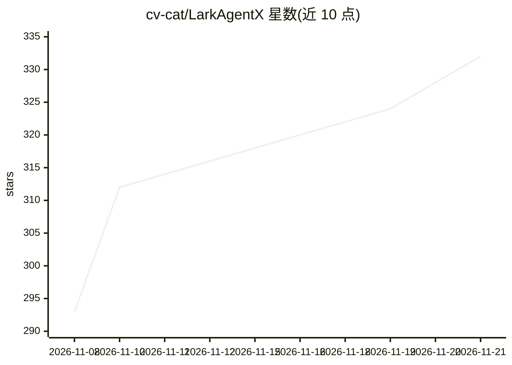

# cv-cat/LarkAgentX

⭐ 332 · Python · 推送 2026-11-11 · [GitHub](https://github.com/cv-cat/LarkAgentX) · [官网](https://larkagentx.cvcat.site) · 个人维护 · 中文 README

**让飞书账号直连本地 Claude Code/Codex 的消息桥接工具**

通过飞书/Lark 网页版内部协议（来自 OpenFeiShuApis）实现扫码登录，将飞书收到的消息交给本机的 Claude Code 或 Codex 处理，并以用户账号发出回复，无需配置官方机器人。支持飞书与 Lark 多账号同时在线，凭证与消息存储在本地 ~/.larkx/。提供 Web 控制台管理账号、聊天记录、回复方式与触发规则，以及 CLI 命令（登录、监听、发消息）。agent 以免确认模式运行可执行任意命令，README 声明仅供学习研究且存在账号风控风险。

## 筛选速览

| 维度 | 判定 | 备注 |
|---|---|---|
| AI 角色 | `ai-ecosystem` | LLM/agent 周边工具 |
| 许可风险 | `none` | — |
| 部署形态 | `library` | 以包/库形式分发 |
| 模型依赖 | — | README 未给出锁定关系 |
| 硬件要求 | — | 无带数字的原话,不猜 |
| 安装摩擦 | `low` | 无编译、无系统依赖或容器化 |
| 成熟度 | — | 结构信号不足 |

## 能力要点

- 飞书/Lark 账号扫码直连，无需创建官方机器人
- 本地 Claude Code 或 Codex 作为后端 agent，每个会话独立上下文
- 多账号同时在线，数据（凭证/消息）存储在本地
- Web 控制台管理账号、回复方式、agent 与触发规则

## 适用场景

- 在飞书聊天里直接调用本机的 Claude Code / Codex 处理消息
- 用个人飞书账号收发消息而不用配置机器人
- 多账号场景下将不同会话路由到本地 agent

## 场景标签

`编码 Agent` · 领域:编码与开发

## 证据(README 行号)

> L14: LarkAgentX 让你的飞书账号直连本地的 coding agent。扫码登录后，收到的消息交给本机的 Claude Code 或 Codex 处理，回复以你的账号发出。无需配置飞书机器人，飞书和 Lark 都支持。
> L48: - **接本地的 agent。** Claude Code 或 Codex 都行，每个会话有自己的上下文。

## 星数曲线

2026-11-08 293 → 2026-11-21 332（+39）

---
*卡片 v1 · prompt 1.4 · 生成 2026-11-17 · 置信度 high · 依据 README sha `ea0546be05da` · [字段定义](../../DATASET.md)*
