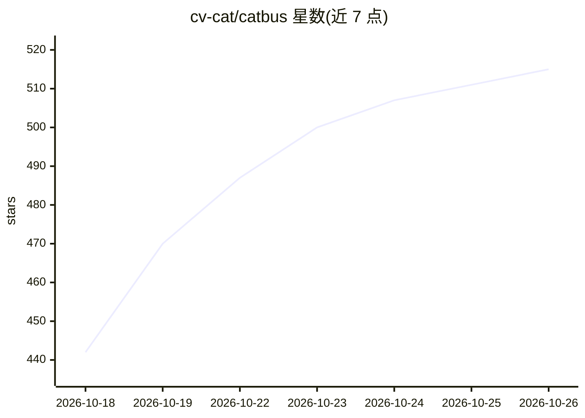

# cv-cat/catbus

⭐ 515 · TypeScript · MIT · 推送 2026-10-25 · [GitHub](https://github.com/cv-cat/catbus) · 个人维护 · 中文 README

**统一 CLI 操作 11 个内容/电商平台的工具，供人和 AI Agent 调用**

Node/TypeScript 编写的命令行工具，用统一语法调用小红书、抖音、TikTok、B 站、快手、微博、闲鱼、淘宝、京东、X、12306 共 11 个平台的 web 端能力：搜索、详情、评论、下载、发布、私信、直播弹幕、余票查询等。输出统一结构的 JSON，凭证按平台×端×账号隔离存放本地，不收集数据、无遥测。为 AI Agent 设计：自描述能力清单、稳定退出码、错误带下一步命令，可通过 npx skills 装入 Claude Code/Cursor/Codex。限学习研究用途，自动化操作可能触发平台风控。

## 筛选速览

| 维度 | 判定 | 备注 |
|---|---|---|
| AI 角色 | `ai-enhanced` | 去掉 AI 部分产品仍成立 |
| 许可风险 | `permissive` | MIT |
| 部署形态 | `library` | 以包/库形式分发 |
| 模型依赖 | — | README 未给出锁定关系 |
| 硬件要求 | — | 无带数字的原话,不猜 |
| 安装摩擦 | `low` | 无编译、无系统依赖或容器化 |
| 成熟度 | — | 结构信号不足 |

## 能力要点

- 同一套命令与 JSON 结构操作 11 个平台，300+ 已实现命令
- stdout 仅 JSON、稳定退出码、error.hint 给出下一步命令
- 560+ 对拍数据与 960+ 离线测试，与上游实现逐字节一致
- 一条 npx 命令把技能装入 Claude Code、Cursor、Codex 等 Agent

## 适用场景

- 跨平台统一搜索与导出内容、评论等数据
- 让 AI Agent 通过 CLI 调用各平台能力并接力处理结果
- 多账号管理各平台登录态并执行自动化操作

## 场景标签

`网页抓取` `浏览器自动化` · 领域:效率与自动化

## 证据(README 行号)

> L56: ### 🤖 为 AI Agent 而生
> L82: ## 🤖 为 AI Agent 而生
> L95: 一条命令把 catbus 技能装进 Claude Code、Cursor、Codex 等 Agent：

## 星数曲线

2026-10-18 442 → 2026-10-26 515（+73）

---
*卡片 v1 · prompt 1.4 · 生成 2026-10-21 · 置信度 high · 依据 README sha `987026adf495` · [字段定义](../../DATASET.md)*
