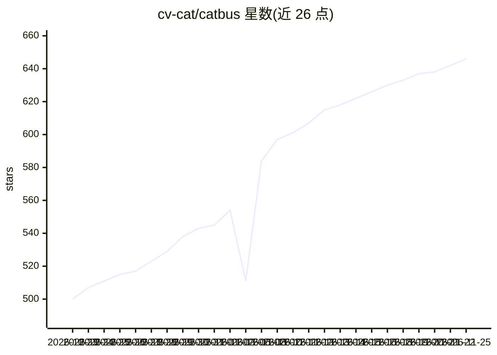

# cv-cat/catbus

⭐ 646 · TypeScript · MIT · 推送 2026-11-23 · [GitHub](https://github.com/cv-cat/catbus) · 个人维护 · 中文 README

**统一 CLI 操作多平台搜索/读取/下载/发布，供人和 AI Agent 使用**

开源 Node.js 命令行工具，用一套 `catbus <platform> <resource> <action>` 命令统一操作 RedNote、抖音、TikTok、B 站、X、YouTube、Discord 等 16 个平台，提供搜索、读取、下载、发布与私信功能，所有命令返回统一 JSON 结构。不依赖浏览器与 Python，直接签名 HTTP 请求。输出 JSON 到 stdout、日志到 stderr、稳定退出码，并可通过 npx skills 安装技能到 Claude Code、Cursor 等 agent 环境。内置 TUI 与本地 Web UI，支持 Docker 与源码安装，凭据本地存储、无遥测。

## 筛选速览

| 维度 | 判定 | 备注 |
|---|---|---|
| AI 角色 | `ai-enhanced` | 去掉 AI 部分产品仍成立 |
| 许可风险 | `permissive` | MIT |
| 部署形态 | `library` | 以包/库形式分发 |
| 模型依赖 | — | README 未给出锁定关系 |
| 硬件要求 | — | 无带数字的原话,不猜 |
| 安装摩擦 | `low` | 无编译、无系统依赖或容器化 |
| 成熟度 | — | 结构信号不足 |

## 能力要点

- 一套命令操作 16 个平台，统一 JSON 输出结构
- 无需浏览器与 Python，仅依赖 Node，支持 Windows/macOS/Linux
- 面向 agent 设计：stdout JSON、stderr 日志、稳定退出码
- 提供 TUI、本地 Web UI 与在线 demo（demo 数据、免登录）

## 适用场景

- 在命令行统一搜索和抓取多平台内容与评论
- 把 catbus 作为技能接入 Claude Code 等 agent 执行平台操作
- 导出某平台内容的全部评论为 JSONL

## 场景标签

`网页抓取` · 领域:效率与自动化

## 证据(README 行号)

> L13: catbus is an open-source CLI that drives every platform with one set of commands: RedNote, Douyin, TikTok, Bilibili
> L65: - **Made for agents.** JSON on stdout, logs on stderr, stable exit codes, and errors that say what to run next.
> L76: Installs the catbus skill into Claude Code, Cursor, Codex and friends. See also llms.txt and AGENTS.md.

## 星数曲线

2026-10-23 500 → 2026-11-25 646（+146）

---
*卡片 v1 · prompt 1.4 · 生成 2026-11-24 · 置信度 high · 依据 README sha `2930039d9ef0` · [字段定义](../../DATASET.md)*
