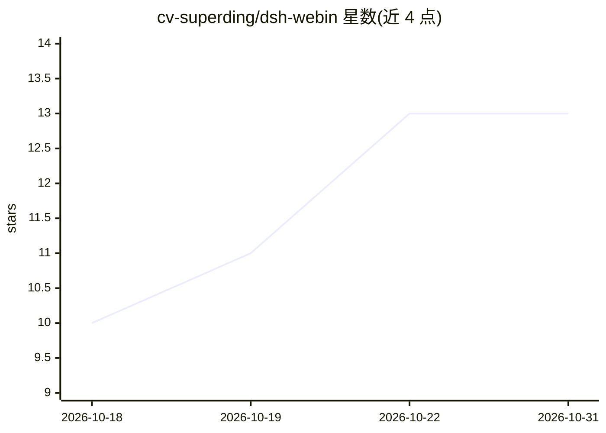

# cv-superding/dsh-webin

⭐ 13 · JavaScript · NOASSERTION · 推送 2026-10-16 · [GitHub](https://github.com/cv-superding/dsh-webin) · 个人维护 · 中文 README

**DSH 插件：用真实浏览器驱动 DeepSeek 等网页版模型**

非官方 DSH 插件，作为 llm adapter 在 DSH 宿主内通过 Electron webview guest 打开真实 Chromium：真实登录、把消息打进网页输入框发送、从页面 DOM 读回复（辅助路径观察页面自身的 SSE），并支持基于 JS 代码块协议的工具调用。内置 DeepSeek/通义千问平台，可通过贴 Provider JSON 添加自定义平台，登录态按平台 workspace 隔离。依赖带 Electron 通道的宿主（官方 DSH Desktop 或自补桥的壳），无桥宿主上发消息会失败。提供发送间隔等 11 项配置与差分发送（后续轮只发增量）。

## 筛选速览

| 维度 | 判定 | 备注 |
|---|---|---|
| AI 角色 | `ai-ecosystem` | LLM/agent 周边工具 |
| 许可风险 | `none` | NOASSERTION |
| 部署形态 | `library` | 以包/库形式分发 |
| 模型依赖 | locked-api |  |
| 硬件要求 | — | 无带数字的原话,不猜 |
| 安装摩擦 | `low` | 无编译、无系统依赖或容器化 |
| 成熟度 | — | 结构信号不足 |

## 能力要点

- 真实浏览器驱动：真实登录、真实输入发送、从页面 DOM 读回复
- 工具调用采用 JS 代码块协议，多行文本用模板字符串免转义
- 差分发送：首轮发全量，后续轮只发新增消息
- 自定义平台用 Provider JSON 热加载，登录态按 workspace 隔离
- 865 项离线测试

## 适用场景

- 在 DSH 中通过网页版账号使用 DeepSeek/通义千问而不调 API
- 利用网页版模型的工具调用能力执行任务
- 通过自定义 Provider JSON 接入其他 AI 网页版站点

## 场景标签

`浏览器自动化` `模型网关` · 领域:Agent 开发

## 证据(README 行号)

> L3: Unofficial DSH plugin — 用**真实浏览器**驱动多个 AI 网页版（DeepSeek / 通义千问 / …）。
> L346: |架构位置|Electron 外壳，自己驱动 AI 页面|DSH 的 `llm` adapter|

## 星数曲线

2026-10-18 10 → 2026-10-31 13（+3）

---
*卡片 v1 · prompt 1.4 · 生成 2026-10-31 · 置信度 mid · 依据 README sha `bed444b3b7f8` · [字段定义](../../DATASET.md)*
