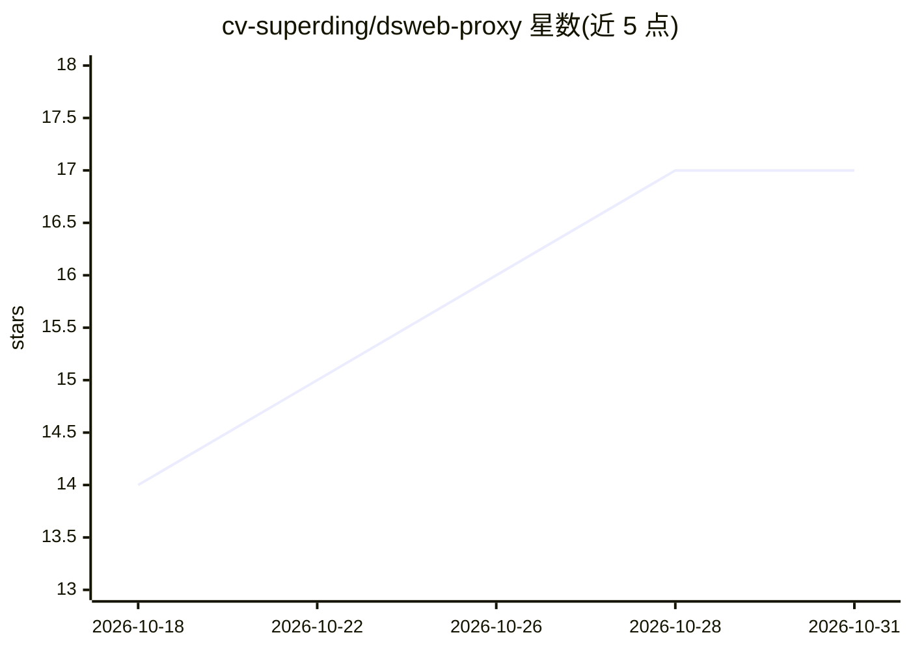

# cv-superding/dsweb-proxy

⭐ 17 · TypeScript · Apache-2.0 · 推送 2026-09-23 · [GitHub](https://github.com/cv-superding/dsweb-proxy) · 个人维护 · 中文 README

**把 DeepSeek/千问/豆包网页登录态转为 OpenAI 兼容本地反代**

用 Tauri 桌面壳 + Node sidecar 的本地反代：通过 CDP 浏览器登录捕获网页版凭证（不用 API Key、走免费额度），在本机 127.0.0.1:8787 起 OpenAI 协议兼容 HTTP 服务，供 ZCode 及 OpenAI 客户端调用。支持三厂商路由、独立账号库、限流自动轮转、SSE 流式与提示词协议模拟工具调用。已知限制：三家网页端均无原生 function calling，存在 WAF/风控/滑块挑战等拦截风险，节流参数需保守。

## 筛选速览

| 维度 | 判定 | 备注 |
|---|---|---|
| AI 角色 | `ai-ecosystem` | LLM/agent 周边工具 |
| 许可风险 | `permissive` | Apache-2.0 |
| 部署形态 | `desktop` | 安装包/桌面程序 |
| 模型依赖 | locked-api |  |
| 硬件要求 | — | 无带数字的原话,不猜 |
| 安装摩擦 | `low` | 无编译、无系统依赖或容器化 |
| 成熟度 | — | 结构信号不足 |

## 能力要点

- 网页登录态（CDP 捕获 token/cookie）→ OpenAI 兼容 /v1/chat/completions
- DeepSeek/千问/豆包三厂商按模型名前缀零配置路由，账号库与轮转独立
- Tauri 桌面应用与 Node CLI 双形态，提供 6 条 CLI 命令与 admin HTTP 接口
- src/registry.ts 注册即可扩展新厂商

## 适用场景

- 让 ZCode 等 OpenAI 客户端使用网页版免费额度
- 免 API Key 在本机调用 deepseek-chat/reasoner、qwen3 系列
- 多账号分组管理与限流自动轮转

## 场景标签

`模型网关` · 领域:Agent 开发

## 证据(README 行号)

> L5: **网页版 → OpenAI 兼容反代**：复用你已登录的网页版账号（不用 API Key、走免费额度），在本机起一个 OpenAI 协议兼容的 HTTP 服务，ZCode / 任何 OpenAI 客户端都能直接把它们当模型用。
> L16: ZCode agent loop ──▶ http://127.0.0.1:8787/v1/chat/completions

## 星数曲线

2026-10-18 14 → 2026-10-31 17（+3）

---
*卡片 v1 · prompt 1.4 · 生成 2026-10-29 · 置信度 high · 依据 README sha `ae69ac2fa790` · [字段定义](../../DATASET.md)*
