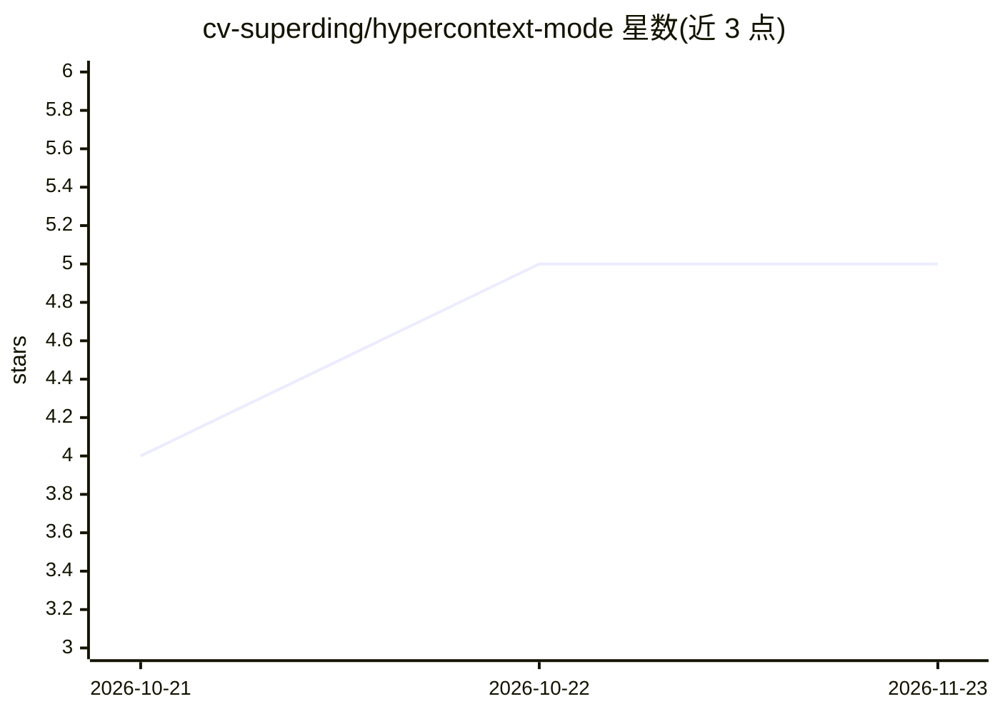

# cv-superding/hypercontext-mode

⭐ 5 · TypeScript · NOASSERTION · 推送 2026-10-21 · [GitHub](https://github.com/cv-superding/hypercontext-mode) · 个人维护 · 中文 README

**给 AI 编码代理统一管理上下文与记忆的运行时**

合并 context-mode 与 billion-context 两个项目的三层运行时：通过 MCP 暴露 ctx_* 工具做沙箱执行、FTS5/BM25 检索与会话记忆；通过 API 代理做对话历史的增量分层压缩与可逆解压。面向 Claude Code、Codex CLI、Qoder 等 34 种编码代理客户端。提供 Windows 原生 WPF 安装器（自动装 Node 与源码、生成 MCP 配置）与 hctx CLI。README 附带本机实测数据，包括失败案例与未验证项。

## 筛选速览

| 维度 | 判定 | 备注 |
|---|---|---|
| AI 角色 | `ai-ecosystem` | LLM/agent 周边工具 |
| 许可风险 | `none` | NOASSERTION |
| 部署形态 | `desktop` | 安装包/桌面程序 |
| 模型依赖 | — | README 未给出锁定关系 |
| 硬件要求 | — | 无带数字的原话,不猜 |
| 安装摩擦 | `low` | 无编译、无系统依赖或容器化 |
| 成熟度 | — | 结构信号不足 |

## 能力要点

- 沙箱执行工具输出，只把派生结果放回上下文（实测单任务净省约 38.7 KB）
- API 代理层提供增量分层压缩与可逆解压，含 autoFold 模式
- FTS5 索引 + BM25/trigram 检索，非语义搜索
- hctx meter 按真实注入开销计量净节省

## 适用场景

- 长会话编码代理中压缩对话历史避免遗忘
- 让 MCP 工具的大输出不直接灌进上下文
- 跨天任务中检索此前会话的记忆

## 场景标签

`Agent 记忆` · 领域:Agent 开发

## 证据(README 行号)

> L9: > Sandboxed tool output + reversible conversation compression, in one runtime.
> L13: - **context-mode** — 管「进入上下文的工具输出」：沙箱执行、FTS5 知识库、会话记忆、hooks 路由、MCP 工具。
> L14: - **billion-context** — 管「已经进入上下文的对话历史」：模型 API 代理、增量分层压缩、可逆解压、前缀缓存友好。

## 星数曲线

2026-10-21 4 → 2026-11-23 5（+1）

---
*卡片 v1 · prompt 1.4 · 生成 2026-11-21 · 置信度 mid · 依据 README sha `6c035084df44` · [字段定义](../../DATASET.md)*
