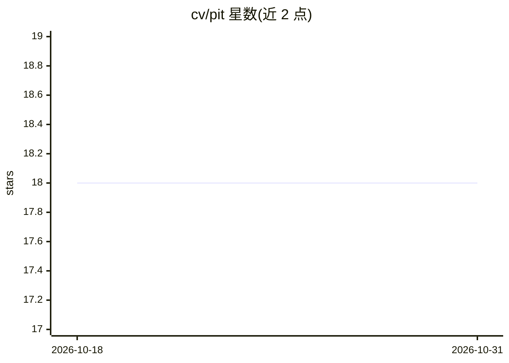

# cv/pit

⭐ 18 · TypeScript · MIT · 推送 2026-10-26 · [GitHub](https://github.com/cv/pit) · [官网](https://github.com/cv/pit/tree/main/docs/case_study) · 个人维护

**把 Pi 编码 agent 的工具箱替换为单一 TypeScript 工具的扩展**

面向 Pi coding agent 的扩展：以单一 `typescript` 工具替换 Pi 内置编码工具，agent 在一次调用中编写 TypeScript 代码，并行完成读文件、执行命令并按逻辑处理后返回摘要。每次调用在独立 QuickJS 沙箱中运行，无直接文件/网络/进程访问，通过依赖注入的函数接触宿主；执行前做类型检查。支持保存与复用工作流函数，兼容其他扩展与 MCP 工具。要求 Node 22.19+，仅支持锁定的 Pi 版本（当前 1.4.0），通过 `pi install git:github.com/cv/pit` 安装，分发于 GitHub 而非 npm。沙箱非审批边界，暴露的函数仍可改文件/联网。

## 筛选速览

| 维度 | 判定 | 备注 |
|---|---|---|
| AI 角色 | `ai-ecosystem` | LLM/agent 周边工具 |
| 许可风险 | `permissive` | MIT |
| 部署形态 | `None` |  |
| 模型依赖 | — | README 未给出锁定关系 |
| 硬件要求 | — | 无带数字的原话,不猜 |
| 安装摩擦 | `low` | 无编译、无系统依赖或容器化 |
| 成熟度 | — | 结构信号不足 |

## 能力要点

- 单一 typescript 工具替换 Pi 内置工具箱，一次调用组合读文件/执行命令/逻辑处理
- 每次调用运行于无直接 I/O 访问的 QuickJS 沙箱，结果有界
- 执行前类型检查，提前发现拼写错误的 方法与错误参数
- 调用可保存为函数，会话内/项目内/跨项目复用

## 适用场景

- 让编码 agent 用一次调用完成原本多次工具往返的工作
- 减少中间输出对对话上下文的占用
- 把常用操作流程保存为可复用函数在团队或项目中共享

## 场景标签

`编码 Agent` · 领域:编码与开发

## 证据(README 行号)

> L3: **One typed tool for Pi, instead of a toolbox.**
> L5: Pit is an extension for the Pi coding agent. It replaces Pi's built-in coding tools with a single `typescript` tool,

## 星数曲线

2026-10-18 18 → 2026-10-31 18（+0）

---
*卡片 v1 · prompt 1.4 · 生成 2026-10-29 · 置信度 high · 依据 README sha `ec8d6e91c9c7` · [字段定义](../../DATASET.md)*
