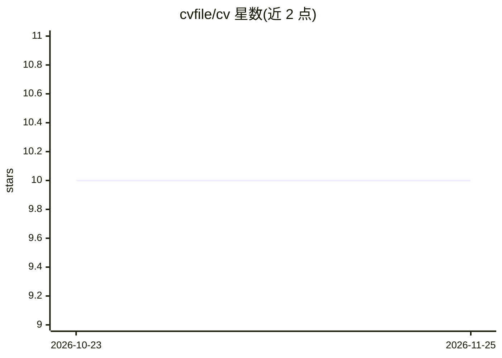

# cvfile/cv

⭐ 10 · TypeScript · Apache-2.0 · 推送 2026-11-23 · [GitHub](https://github.com/cvfile/cv) · [官网](https://cvfile.org) · 组织维护

**给求职者/开发者的一体化简历开放文件格式**

.cv 是一种开放简历文件格式（Apache 2.0 代码、CC BY 4.0 规范、IANA 媒体类型）：单个 PDF/A-3u 文件内嵌 Markdown、HTML、JSON Resume 副本与预计算 BGE-M3 向量，附 XMP 元数据与 SHA-256 完整性校验。人类用 PDF 阅读器打开，ATS 读 Markdown 副本，AI agent/RAG 管线直接读取文本与向量。提供 JS/Python/Go SDK、Go CLI、Web 组件与服务器 content negotiation 中间件，并附 LangChain/LlamaIndex/Haystack 加载器。限制：向量检索需 HF_TOKEN，非合规验证器不扫描恶意构造。

## 筛选速览

| 维度 | 判定 | 备注 |
|---|---|---|
| AI 角色 | `ai-enhanced` | 去掉 AI 部分产品仍成立 |
| 许可风险 | `permissive` | Apache-2.0 |
| 部署形态 | `library` | 以包/库形式分发 |
| 模型依赖 | — | README 未给出锁定关系 |
| 硬件要求 | — | 无带数字的原话,不猜 |
| 安装摩擦 | `low` | 无编译、无系统依赖或容器化 |
| 成熟度 | — | 结构信号不足 |

## 能力要点

- 单文件同时携带 PDF、Markdown、HTML、JSON Resume 与 BGE-M3 嵌入向量
- SHA-256 per-payload 完整性摘要与安全校验（拒绝加密/JS/Launch 等构造）
- 按 URL content negotiation 分发：浏览器取 PDF，AI 爬虫取 Markdown
- 三种语言 SDK 字节级互操作，veraPDF 在 CI 中校验 PDF/A-3u 合规

## 适用场景

- 把同一份简历上传到 Workday、Greenhouse、LinkedIn 并保持一致
- 招聘侧 AI 工具直接读文本与向量，跳过 OCR 与重新嵌入
- 团队页面用 <cv-embed> 一行标签嵌入可被搜索引擎索引的简历
- 中英双语简历以 alternate payload 形式共存于一个文件

## 场景标签

`RAG` · 领域:知识与检索

## 证据(README 行号)

> L9: **A `.cv` file is a single resume file that is a printable PDF, a clean Markdown copy for applicant tracking systems
> L29: - **AI agents and RAG pipelines** read the embedded Markdown and the precomputed **BGE-M3 embeddings** directly, wi
> L155: |`@cvfile/mcp`|npm|MCP server: list, validate, read, pack, and semantic search over local .cv files from AI agents

## 星数曲线

2026-10-23 10 → 2026-11-25 10（+0）

---
*卡片 v1 · prompt 1.4 · 生成 2026-11-19 · 置信度 high · 依据 README sha `63531bb648de` · [字段定义](../../DATASET.md)*
