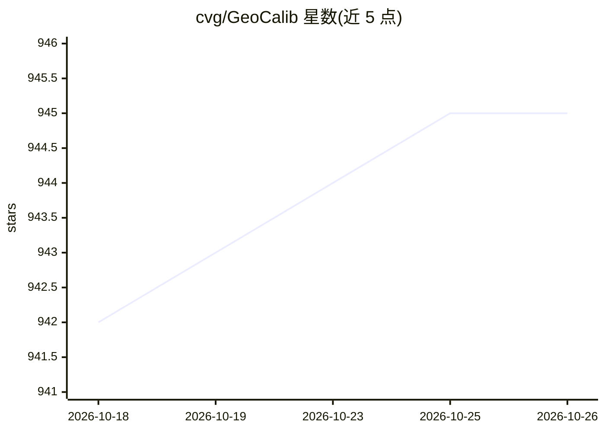

# cvg/GeoCalib

⭐ 945 · Python · Apache-2.0 · 推送 2026-10-14 · [GitHub](https://github.com/cvg/GeoCalib) · 组织维护

**单张图像相机内参与重力方向估计（深度学习+几何优化）**

ECCV 2024 论文的官方代码库：GeoCalib 算法从单张图像估计相机内参（焦距、畸变）与重力方向，方法为深度学习与几何优化结合。提供轻量推理包 geocalib（Python >= 3.9）、torch.hub 加载、网络摄像头交互演示，支持 pinhole/radial/divisional 等四种相机模型，以及已知内参/重力的部分标定、多图共享内参与多相机刚体联合标定。完整评测与训练代码位于 siclib 库，在 LaMAR/MegaDepth/TartanAir/Stanford2D3D 等数据集上给出与 DeepCalib、ParamNet、UVP 的对比结果；自建训练集 OpenPano 提供下载说明。限制：主点固定于图像中心不参与优化。

## 筛选速览

| 维度 | 判定 | 备注 |
|---|---|---|
| AI 角色 | `ai-native` | 本体是模型或模型工具 |
| 许可风险 | `permissive` | Apache-2.0 |
| 部署形态 | `library` | 以包/库形式分发 |
| 模型依赖 | — | README 未给出锁定关系 |
| 硬件要求 | — | 无带数字的原话,不猜 |
| 安装摩擦 | `medium` | 含编译或系统依赖之一 |
| 成熟度 | — | 结构信号不足 |

## 能力要点

- 单图同时估计相机内参与重力方向
- 支持 pinhole/simple_radial/radial/simple_divisional 四种相机模型
- 支持部分标定先验、多图共享内参、刚体多相机联合重力估计
- 提供 geocalib 轻量推理包、torch.hub 加载与网络摄像头交互演示

## 适用场景

- 从单张照片估计相机焦距与水平线
- 为 3D 重建/SLAM/AR 流程提供图像级内参初值
- 用网络摄像头实时查看标定与去畸变结果

## 场景标签

 · 领域:计算机视觉/相机标定

## 证据(README 行号)

> L19:  GeoCalib accurately estimates the camera intrinsics and gravity direction from a single image
> L25: GeoCalib is an algorithm for single-image calibration: it estimates the camera intrinsics and gravity direction fro

## 星数曲线

2026-10-18 942 → 2026-10-26 945（+3）

---
*卡片 v1 · prompt 1.4 · 生成 2026-10-21 · 置信度 high · 依据 README sha `1dfc6e622212` · [字段定义](../../DATASET.md)*
